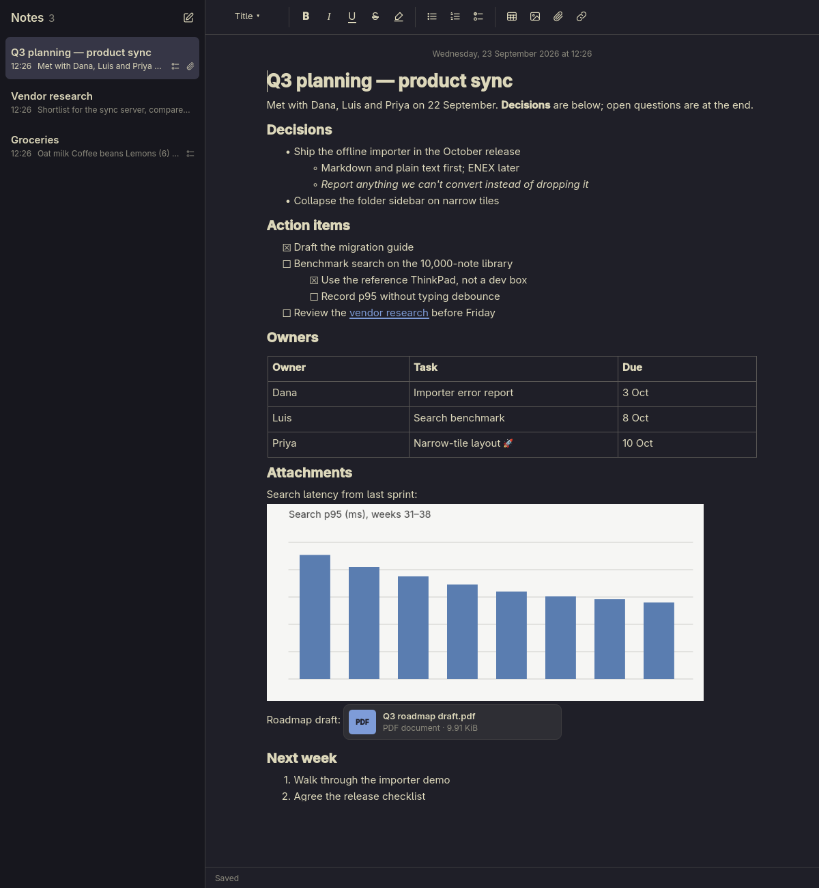
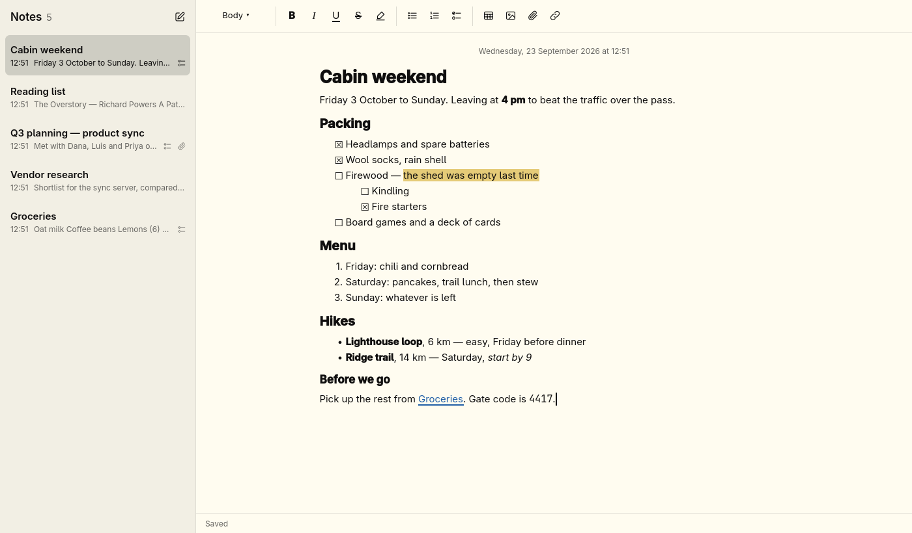
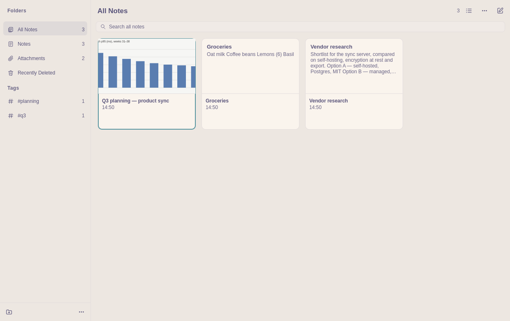

<div align="center">

# 📝 Omarchy Notes

**Local, offline notes for [Omarchy](https://omarchy.org).**

Two native editions: **Rust 1.0 with GPUI**, and the existing **Qt edition**.
Rich notes stay on your machine, with no account required.

[](LICENSE)
[](https://github.com/last-refuge/omarchy-notes/releases/tag/rust-v1.0.0)


[Download Rust 1.0](https://github.com/last-refuge/omarchy-notes/releases/tag/rust-v1.0.0) · [Qt edition](#qt-edition)

</div>

## Rust 1.0

The separate Rust edition ships for **x86_64 Arch/Omarchy on Wayland/Hyprland**.
It includes rich writing, headings, lists, checklists, basic tables, links,
images and files; autosave and recovery; Quick Note and durable CLI capture;
nested folders, pins, sorting, prefix search and Recently Deleted.

**Settings → Data** provides reviewed Markdown/text file or folder imports,
Markdown/HTML note exports, library Markdown with assets, complete backups,
inspection and restore into a new library. Export a note as PDF from the toolbar
or with **Ctrl+Shift+P**. Portable exports are useful copies; use a library backup
when you need exact preservation.

| Workflow | Rust 1.0 | Qt edition |
|---|---|---|
| Rich notes, basic tables, images and files | Available; existing merged cells are preserved | Available |
| Folders, pins, search, sorting and deletion recovery | Available | Available |
| Quick Note, import/export and library backups | Available | Available |
| Tags and Smart Folders | Interfaces deferred; existing metadata preserved | Available |
| Gallery and library-wide attachment browser | Deferred | Available |
| Automatic Hyprland Quick Note setup | Desktop action or a distinct manual binding | Optional setup command |

Rust is a separate edition, not a complete replacement for Qt. See the
[Rust release notes](docs/rust-release-notes.md) for scope and recorded follow-up,
and the [installation and recovery guide](docs/rust-release.md) for details.

### Install Rust 1.0

Download the **published Rust release installer** and inspect it before running:

```bash
curl -fsSL https://github.com/last-refuge/omarchy-notes/releases/download/rust-v1.0.0/install.sh -o install.sh
bash install.sh --edition rust --version rust-v1.0.0 --dry-run
bash install.sh --edition rust --version rust-v1.0.0 --no-quick-note
```

The installer verifies the release checksum and package identity, then uses
pacman. Open **Omarchy Notes (Rust)** from your launcher, or run
`omarchy-notes-rust`. The `omarchy-notes-preview` compatibility launcher forwards
to Rust; an older manual preview earlier on `PATH` may need moving aside.

Choose **Rust Quick Note** from the desktop launcher's actions, run
`omarchy-notes-rust --quick-note`, or press **Ctrl+Shift+N** inside Rust.
**Ctrl+Shift+O** moves Quick Note into the main window. Use a distinct compositor
binding if you want a global shortcut; Rust does not run Qt's automatic setup.

Rust keeps notes in `~/.local/share/omarchy-notes-gpui/` and preferences in
`~/.config/omarchy-notes-gpui/` (or the corresponding XDG locations). Qt uses
separate directories. Removing `omarchy-notes-rust` retains your data.
Use copies and verified backups when opening Qt libraries. Quotation/schema-3
libraries require Rust; returning to Qt uses the pre-upgrade backup and excludes
later Rust edits. Keep the newer library and export or back it up before rollback.

### Rust screenshots

The dark writing view is shown above. These are screenshots of the released
Rust 1.0 application, using a sample library.

| Light writing | Quick Note |
|---|---|
| [](docs/images/rust-v1-writing-light.png) | [](docs/images/rust-v1-quick-note.png) |
| **Folders** | **Data and backups** |
| [](docs/images/rust-v1-folders.png) | [](docs/images/rust-v1-portability.png) |

[](docs/images/rust-v1-recovery.png)

## Qt edition

Qt remains available as `omarchy-notes`, with its own library and desktop
identity. It supports tags, Smart Folders, gallery and the attachment browser,
in addition to the writing workflows below. The installer **defaults to Qt**;
Rust always requires explicit edition selection.

<details>
<summary><b>Qt features</b></summary>

- ⚡ **Start typing right away.** Notes save automatically, usually within a second. "Saved" only appears once your note is actually on disk.
- ✍️ **Format like you'd expect:** title, heading and subheading styles, plus bold, italic, underline, strikethrough, highlight and monospace.
- ✅ **Checklists and lists.** Bulleted, numbered and checklist items, nested as deep as you like. Click a checkbox to tick it off.
- 📊 **Tables.** Tab moves between cells, and Tab in the last cell adds a new row.
- 🖼️ **Images and attachments.** Add images from the toolbar or paste them in, and attach PDFs or any other file. Double-click one to open it in its usual app.
- 🔗 **Link notes together.** Ctrl+L links to another note, and Ctrl+click follows a link.
- 🗂️ **Folders.** Nest folders as deep as you like, move notes between them, and use All Notes to see everything at once.
- 🏷️ **Tags.** Type `#anything` in a note and it becomes a tag, listed in the sidebar with a count. Ctrl+click a tag to see every note that has it.
- ✨ **Smart Folders.** Save a filter, like "tagged #work, has a checklist, edited this week", and it stays up to date by itself.
- 🖼️ **Gallery and attachments.** Flip the note list to a gallery of cards with image previews, or browse every image and file across all your notes in one place.
- ⚡ **Quick Note.** A small window for jotting something down without opening the whole app. It's in the launcher menu, and you can bind it to a key (see below).
- 🔍 **Search everything.** Results appear as you type, with the matching words in bold. Partial words work too: "bench" finds "benchmark". Ctrl+F finds text inside the note you're reading.
- 📤 **Your notes aren't locked in.** Import Markdown and text files (including their images), export any note as Markdown, HTML or PDF, or export everything as a folder of Markdown files.
- 📌 **Pin what matters.** Pinned notes stay at the top. Sort the rest by date edited, date created or title.
- 🗑️ **Undo a delete.** Deleted notes wait in Recently Deleted for 30 days before they're gone for good. Deleting a folder moves its notes there too.
- 💾 **Backups you can trust.** One click saves a complete copy of your library, attachments included. Restoring checks the backup first and keeps your current notes aside, so you can always go back.
- 📋 **Copy and paste that behaves.** Copying between notes keeps everything intact. Text pasted from the web gets tidied into clean note formatting, and anything that can't come along, like images from other sites, gets a heads-up instead of vanishing silently.
- 🎨 **Matches your theme.** Colours come from your active Omarchy theme and are adjusted automatically when they'd be hard to read.
- 🌐 **Every language.** Emoji, right-to-left scripts, CJK and input methods (IME) all work.
- 🛟 **Hard to lose work.** If a save fails, your text stays on screen with Retry and Export buttons, and the app won't quit until your changes are safe or you choose to discard them.

</details>

<details>
<summary><b>Qt edition screenshots</b></summary>







</details>

### Install Qt

The published edition-aware installer supports both apps. Without
`--edition rust`, it selects Qt; these commands pin the existing Qt release:

```bash
curl -fsSL https://github.com/last-refuge/omarchy-notes/releases/download/rust-v1.0.0/install.sh -o install.sh
bash install.sh --version v1.0.0
```

After installation, open **Omarchy Notes** from your launcher. To preview, build
from source, or request Qt's optional Quick Note setup:

```bash
bash install.sh --version v1.0.0 --dry-run
bash install.sh --version v1.0.0 --source
bash install.sh --version v1.0.0 --quick-note
```

`--yes` accepts package installation, but does not enable Quick Note by itself.
`--no-quick-note` skips setup. `NO_COLOR=1` disables colour and animation.
Downloads never switch to a source build automatically. Run the installer again
to update, then close and reopen the app normally. Removing Qt keeps its notes:

```bash
sudo pacman -R omarchy-notes
```

### Qt package installation

You can also install the **v1.0.0 x86_64 package** directly:

```bash
sudo pacman -U https://github.com/last-refuge/omarchy-notes/releases/download/v1.0.0/omarchy-notes-1.0.0-1-x86_64.pkg.tar.zst
```

### Building Qt from source

For a Qt release package on Arch, use `bash install.sh --version v1.0.0 --source`. To build a user-local
copy yourself, follow the steps below. Other Linux systems need equivalent build
tools, Qt 6.8 or newer, and SQLite.

**1. Install the build tools:**

```bash
sudo pacman -S --needed qt6-base qt6-declarative qt6-wayland qt6-svg sqlite cmake ninja gcc pkgconf
```

**2. Build and install it for your user:**

```bash
git clone https://github.com/last-refuge/omarchy-notes.git
cd omarchy-notes
cmake -S . -B build-release -G Ninja -DCMAKE_BUILD_TYPE=Release -DCMAKE_INSTALL_PREFIX="$HOME/.local"
cmake --build build-release
cmake --install build-release
```

That puts `omarchy-notes` in `~/.local/bin` and adds it to your app launcher.

> [!TIP]
> If it doesn't show up in the launcher right away, run `omarchy restart shell` so the launcher picks up the new app.

To update later, `git pull` and run the last two `cmake` commands again. Your notes aren't touched.

### Qt Quick Note on a key (optional)

Let the app set it up. It checks your existing bindings (and Omarchy's) first, never overwrites a key that's taken, and backs up anything it changes:

```bash
omarchy-notes --setup-hyprland
```

Or do it by hand. Add a binding to `~/.config/hypr/bindings.lua`. <kbd>Super</kbd> <kbd>Alt</kbd> <kbd>N</kbd> is free in a default Omarchy setup:

```lua
o.bind("SUPER + ALT + N", "Quick Note", { launch = "omarchy-notes --quick-note" })
```

To make the Quick Note window float, add this to `~/.config/hypr/hyprland.lua`:

```lua
o.window({ class = "^org\\.omarchy\\.Notes$", title = "^Quick Note$" }, { tag = "+floating-window" })
```

### Qt data and backups

Everything is stored in `~/.local/share/omarchy-notes/`: an SQLite database for your notes, plus a folder of attached files. Reinstalling or removing the app never touches it.

To back up, click **⋯** at the bottom of the folder list and choose **Back Up Library…**. You get a normal folder with a consistent copy of everything, which is safe to make while you're writing. **Restore from Backup…** in the same menu checks a backup before using it and sets your current notes aside next to the library, so nothing is lost if you change your mind.

Coming from Apple Notes, Obsidian or another app? See [moving your notes in](docs/migrating.md).

Want a sandbox to play in? Point the app at a different folder and fill it with sample notes:

```bash
omarchy-notes --data-dir /tmp/notes-playground --samples
```

<details>
<summary><b>All command-line options</b></summary>

| Option | What it does |
|---|---|
| `--data-dir <dir>` | Use a notes library in a different folder |
| `--new` | Start with a fresh note |
| `--note <id>` | Open a specific note |
| `--quick-note` | Open a Quick Note window |
| `--capture <text>` | Save text as a new note without opening a window (use `-` to read from a pipe, like `echo "idea" \| omarchy-notes --capture -`) |
| `--setup-hyprland` | Add a Quick Note key (<kbd>Super</kbd>+<kbd>Alt</kbd>+<kbd>N</kbd>) and floating rule to Hyprland, if the key is free |
| `--samples` | Fill an empty library with example notes (a meeting note with a table, image and PDF, some research links, and a grocery list) |
| `--simulate-save-failure` | Make saves fail on purpose, to see how the app handles it. <kbd>Ctrl</kbd>+<kbd>Alt</kbd>+<kbd>Shift</kbd>+<kbd>F</kbd> toggles this while running |

</details>

### Qt keyboard shortcuts

| | Shortcut |
|---|---|
| New note · New folder | <kbd>Ctrl</kbd> <kbd>N</kbd> · <kbd>Ctrl</kbd> <kbd>Shift</kbd> <kbd>N</kbd> |
| Search all notes · Find in note | <kbd>Ctrl</kbd> <kbd>Shift</kbd> <kbd>F</kbd> · <kbd>Ctrl</kbd> <kbd>F</kbd> (then <kbd>F3</kbd> / <kbd>Enter</kbd> for the next match) |
| Delete the selected note | <kbd>Delete</kbd> (in the note list) |
| Duplicate note | <kbd>Ctrl</kbd> <kbd>D</kbd> |
| Show or hide folders | <kbd>Ctrl</kbd> <kbd>Shift</kbd> <kbd>S</kbd> |
| Bold · Italic · Underline | <kbd>Ctrl</kbd> <kbd>B</kbd> · <kbd>Ctrl</kbd> <kbd>I</kbd> · <kbd>Ctrl</kbd> <kbd>U</kbd> |
| Strikethrough · Highlight · Monospace | <kbd>Ctrl</kbd> <kbd>Shift</kbd> <kbd>X</kbd> · <kbd>Ctrl</kbd> <kbd>Shift</kbd> <kbd>Y</kbd> · <kbd>Ctrl</kbd> <kbd>E</kbd> |
| Title · Heading · Subheading · Body | <kbd>Ctrl</kbd> <kbd>Shift</kbd> + <kbd>T</kbd> · <kbd>H</kbd> · <kbd>J</kbd> · <kbd>B</kbd> |
| Checklist · Tick an item | <kbd>Ctrl</kbd> <kbd>Shift</kbd> <kbd>L</kbd> · <kbd>Ctrl</kbd> <kbd>Shift</kbd> <kbd>U</kbd> |
| Bulleted · Numbered list | <kbd>Ctrl</kbd> <kbd>Shift</kbd> <kbd>8</kbd> · <kbd>Ctrl</kbd> <kbd>Shift</kbd> <kbd>7</kbd> |
| Indent · Outdent a list item | <kbd>Tab</kbd> · <kbd>Shift</kbd> <kbd>Tab</kbd> |
| Insert a table | <kbd>Ctrl</kbd> <kbd>Alt</kbd> <kbd>T</kbd> |
| Attach a file · Link to a note | <kbd>Ctrl</kbd> <kbd>Shift</kbd> <kbd>A</kbd> · <kbd>Ctrl</kbd> <kbd>L</kbd> |
| Follow a link or #tag · Open an attachment | <kbd>Ctrl</kbd> + click · double-click (or <kbd>Ctrl</kbd> <kbd>Enter</kbd> next to it) |

### Qt roadmap

| | Milestone | What it brings |
|---|---|---|
| ✅ | **Editor & storage** | Rich editing, autosave, crash-safe storage, theme support |
| ✅ | **Daily-use alpha** | Delete & trash, folders, pinning, search, backup & restore |
| ✅ | **Local beta** | Tags, Smart Folders, gallery view, import/export, Quick Note, find in note |
| ✅ | **1.0** | Arch package, accessibility polish, performance targets met ([numbers](docs/performance.md)) |
| 💭 | **After 1.0** | Locked notes, OCR, audio, sync between devices, sharing |

The Qt plan is in [`llm-docs/omarchy-notes-plan.md`](llm-docs/omarchy-notes-plan.md), with a visual version in [`llm-docs/roadmap.html`](llm-docs/roadmap.html) (download it and open it in a browser). Big technical decisions are written up in [`docs/decisions/`](docs/decisions/).

## 🛠️ Hacking on it

For Rust development, see the [Rust build guide](docs/rust-release.md) and the
[`crates/`](crates/) workspace. The Cargo package retains its historical name;
the application executable is `omarchy-notes-rust`.

```bash
cargo run --release --locked -p omarchy-notes-preview --bin omarchy-notes-rust
cargo test --workspace --locked
```

For Qt development, build a debug version and run the tests:

```bash
cmake -S . -B build -G Ninja -DCMAKE_BUILD_TYPE=Debug
cmake --build build
ctest --test-dir build --output-on-failure
```

The Qt editor tests drive the real app off-screen and save screenshots to `build/screenshots/`, which is handy for checking what changed visually. `tests/bench_library` measures the performance targets, and [docs/arch-release.md](docs/arch-release.md) explains how releases are made.

| Folder | What's inside |
|---|---|
| [`crates`](crates) | Rust core, editor, UI, platform, storage and import/export libraries. |
| [`src/core`](src/core) | The engine: the note format, saving to SQLite, attachment storage and theme colours. There's no UI code in here. |
| [`src/app`](src/app) | The app itself: the editor logic and the Qt Quick (QML) interface. |
| [`tests`](tests) | Round-trip, storage (including a "kill it mid-save" durability test), theme contrast, end-to-end editor and launch tests, plus packaging checks. |
| [`packaging`](packaging) | Desktop entry, icon, AppStream metadata, man page and the AUR recipe template. |

Found a bug or have an idea? [Open an issue](https://github.com/last-refuge/omarchy-notes/issues). It's early days, so feedback shapes where this goes.

## 🔒 Security

If you find a security issue, please **don't** open a public issue. Report it privately by following the steps in [SECURITY.md](SECURITY.md).

## 📄 License

Omarchy Notes is released under the [MIT License](LICENSE).

---

<div align="center">
Made for <a href="https://omarchy.org">Omarchy</a> 🖤 · Not affiliated with Apple or the Omarchy project
</div>
