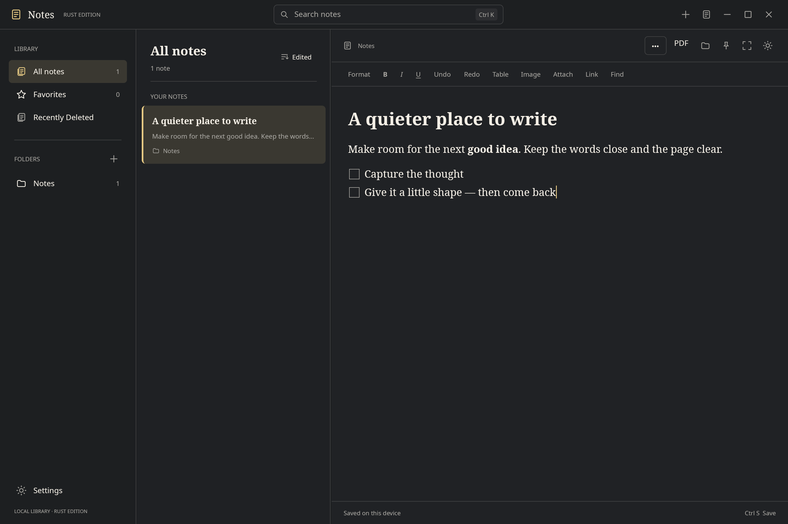
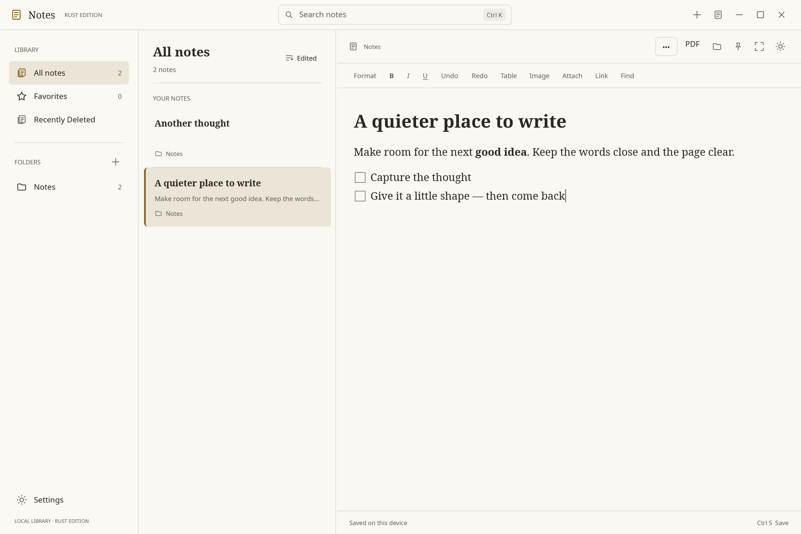
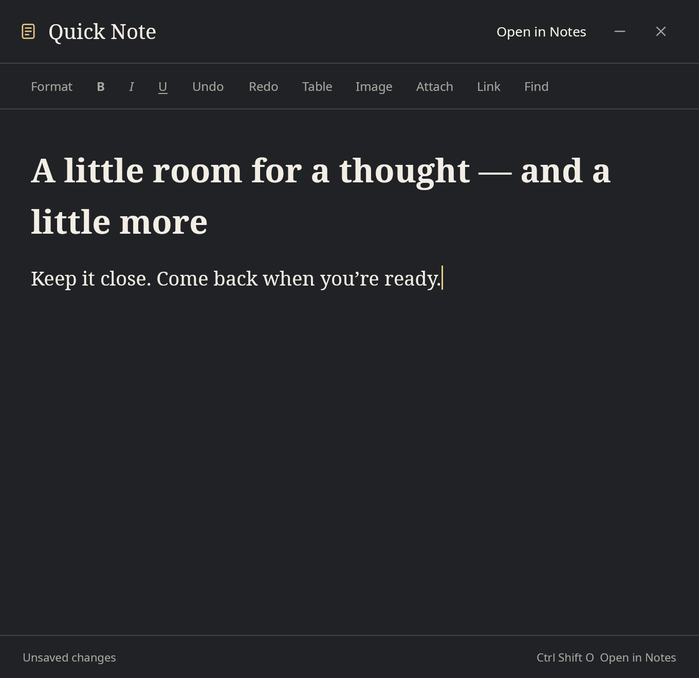
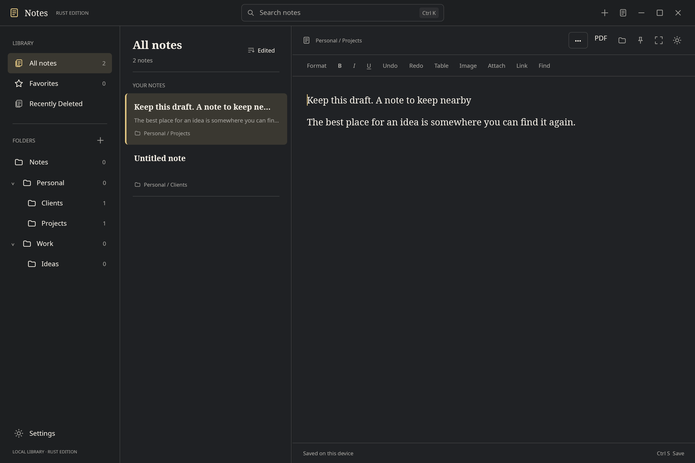
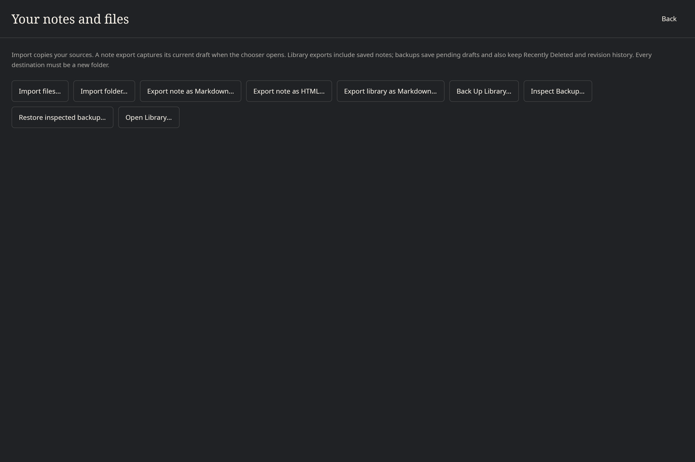
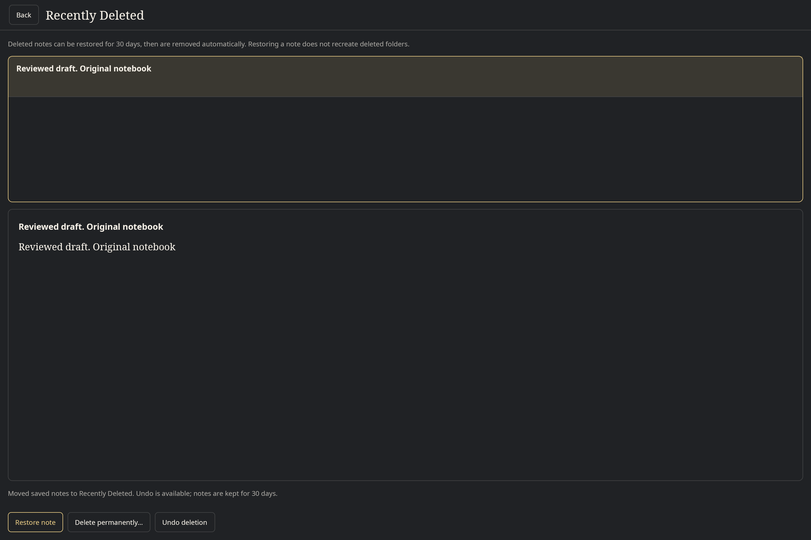

<div align="center">

# 📝 Omarchy Notes

**Local, offline notes for [Omarchy](https://omarchy.org).**

A native app built with **Rust and GPUI**. Rich notes stay on your machine,
with no account required. Rust is the only maintained implementation.

[](LICENSE)
[](https://github.com/last-refuge/omarchy-notes/releases/tag/rust-v1.0.0)




[Download Omarchy Notes 1.0](https://github.com/last-refuge/omarchy-notes/releases/tag/rust-v1.0.0)

</div>

## What’s included

Omarchy Notes ships for **x86_64 Arch/Omarchy on Wayland/Hyprland**. It includes
rich writing, headings, lists, checklists, basic tables, links, images and files;
autosave and recovery; Quick Note and durable CLI capture; nested folders, pins,
sorting, prefix search and Recently Deleted.

**Settings → Your notes and files → Import, export & backups** provides reviewed
Markdown/text file or folder imports, Markdown/HTML note exports, library Markdown
with assets, complete backups, inspection and restore into a new library. Export
a note as PDF from the toolbar or with **Ctrl+Shift+P**. Portable exports are useful
copies; use a library backup when you need exact preservation.

**Scope limits:** Tags/Smart Folder interfaces, advanced table operations (including
new merges), gallery, library-wide attachment browsing, drag filing, bulk
organization and browsable revision history are deferred. Existing metadata,
merged tables and revisions are preserved. Automatic Hyprland shortcut setup is
not implemented. X11 and other architectures are not advertised as tested.

The Qt app is **retired**, not a current install, build or support option. Legacy
Qt data compatibility remains for [migration](docs/migrating.md); retirement does
not imply full parity with its former features. See the
[release notes](docs/rust-release-notes.md) for remaining native/package and human
usability verification gaps.

## Install

On Omarchy or Arch Linux, run:

```bash
curl -fsSL https://raw.githubusercontent.com/last-refuge/omarchy-notes/main/install.sh | bash
```

This installs the latest stable Omarchy Notes release. There is only one app;
no edition selector is needed. The installer verifies the release checksum and
package identity, then uses pacman. You can [inspect the script](install.sh)
before running it. Open **Omarchy Notes** from your launcher, or run
`omarchy-notes-rust`. The `omarchy-notes-preview` compatibility launcher forwards
to Rust; an older manual preview earlier on `PATH` may need moving aside.
The binary and Arch package remain `omarchy-notes-rust`, and the desktop ID remains
`org.omarchy.Notes.Rust`.

Run the installer again to update, then close and reopen the app normally.
Downloads do not silently fall back to source builds. Removing the package with
`sudo pacman -R omarchy-notes-rust` retains your notes and preferences.
See the [build, install and recovery guide](docs/rust-release.md).

### Quick Note

Choose **Quick Note** from the desktop launcher's actions, run
`omarchy-notes-rust --quick-note`, or press **Ctrl+Shift+N** inside the app.
**Ctrl+Shift+O** moves Quick Note into the main window. Use a distinct, unused
compositor binding if you want a global shortcut; automatic setup is unavailable.

```bash
printf 'A thought to keep\nSome details.' | omarchy-notes-rust --capture -
```

Capture supports durable receipts and safe retry with `--request-id UUID` and
`--capture-status UUID`; see the [writing and capture guide](docs/gpui-preview.md).

### Data and migration

Notes remain in `~/.local/share/omarchy-notes-gpui/` and preferences in
`~/.config/omarchy-notes-gpui/` (or the corresponding XDG locations). These
historical profile names are unchanged. Data and backups are not encrypted.

Use copies and verified backups when bringing in retired Qt libraries; the original
library is never selected automatically. Quotation/schema-3 libraries require
Rust. A legacy rollback can only use the pre-upgrade backup and excludes later
Rust edits; preserve the newer library and export or back it up first.
See [migration](docs/migrating.md) and [data ownership](docs/rust-data-ownership.md).

## Screenshots

These are screenshots of the released Omarchy Notes 1.0 application using a sample library.

| Light writing | Quick Note |
|---|---|
| [](docs/images/rust-v1-writing-light.png) | [](docs/images/rust-v1-quick-note.png) |
| **Folders** | **Data and backups** |
| [](docs/images/rust-v1-folders.png) | [](docs/images/rust-v1-portability.png) |

[](docs/images/rust-v1-recovery.png)

## Development

See the [Rust build guide](docs/rust-release.md),
[writing guide](docs/gpui-preview.md), [performance diagnostics](docs/rust-performance.md)
and [native acceptance guide](docs/rust-native-acceptance.md).
Build with Cargo using the pinned toolchain in `rust-toolchain.toml`. See the
build guide for native system dependencies. There is no Qt or CMake app build.
The Cargo package retains its historical name, `omarchy-notes-preview`; the
executable is `omarchy-notes-rust`:

```bash
cargo build --release --locked -p omarchy-notes-preview --bin omarchy-notes-rust
./target/release/omarchy-notes-rust
```

Run the Rust checks:

```bash
cargo test --workspace --locked
cargo fmt --all --check
cargo clippy --workspace --all-targets --all-features --locked -- -D warnings
```

Frozen legacy Qt library fixtures remain for migration regression tests; the
Qt source, QML, packaging and live Qt test probes have been removed.

| Folder | Contents |
|---|---|
| [`crates`](crates) | Rust core, editor, UI, platform, storage and import/export libraries |
| [`packaging`](packaging) | Package recipes, desktop metadata, icons and man pages |
| [`tests`](tests) | Storage, editor, native acceptance, migration and packaging checks |
| [`docs/decisions`](docs/decisions) | Historical architecture decisions, not current installation guidance |
| [`llm-docs`](llm-docs) | Historical plans and evidence ledgers; old Qt support/default statements are superseded |

Found a bug or idea? [Open an issue](https://github.com/last-refuge/omarchy-notes/issues).

## Security and license

Report security issues privately via [SECURITY.md](SECURITY.md).
Omarchy Notes is released under the [MIT License](LICENSE).

Not affiliated with Apple or the Omarchy project.
