# Omarchy Notes writing and capture guide

Omarchy Notes is Rust-only; Qt is retired and mentioned below only for legacy
format migration. This guide retains incremental screenshots and verification
notes from development. Old milestone gates are historical, not current support
policy. For current release scope and unverified acceptance items, see the
[release notes](rust-release-notes.md).

Omarchy Notes creates, edits and saves real notes with inline images,
attachment cards, rich clipboard exchange and carefully typeset PDF export. It pairs a quiet,
serif writing surface with graphite/champagne and warm-paper appearances,
selection-aware formatting controls, focus mode and layouts down to 420 logical
pixels. The current installer installs Omarchy Notes. Retirement of Qt does not close
the native/package or human usability verification gaps.

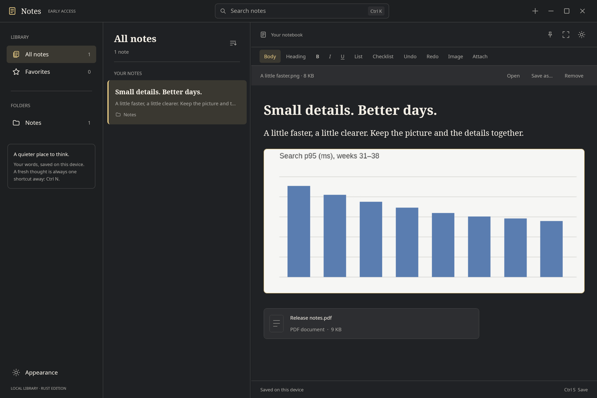

[Warm paper](images/gpui-media-light.png) ·
[Compact media](images/gpui-media-narrow.png) ·
[420-pixel layout](images/gpui-media-420.png) ·
[Save-error recovery](images/gpui-writing-error.png)

## Run it

Install the Rust toolchain declared in `rust-toolchain.toml` through rustup. On
Arch, development dependencies include `base-devel`, `clang`, `cmake`, `pkgconf`,
`fontconfig`, `freetype2`, `libxkbcommon`, `libxcb`, `wayland`, `vulkan-headers`,
`vulkan-icd-loader`, `cairo`, `pango` and a working GPU driver. PDF typography
uses installed fonts: `noto-fonts` is recommended, with `noto-fonts-cjk`,
`noto-fonts-emoji` and fonts for the languages you write in. Do not run Cargo as root.

```sh
cargo run --release --locked -p omarchy-notes-preview --bin omarchy-notes-rust -- --reference
cargo run --release --locked -p omarchy-notes-preview --bin omarchy-notes-rust -- --light
# Choose a new library explicitly:
cargo run --release --locked -p omarchy-notes-preview --bin omarchy-notes-rust -- --data-dir /tmp/my-rust-notebook
# The original disposable design sample remains opt-in:
cargo run --release --locked -p omarchy-notes-preview --bin omarchy-notes-rust -- --demo --reference
```

Normal launches use `$XDG_DATA_HOME/omarchy-notes-gpui`, falling back to
`~/.local/share/omarchy-notes-gpui`. The retired Qt library is never selected
automatically. `--data-dir` can open a compatible library; use a consistent
backup/copy for compatibility testing, and close the other edition first.
The editions exclude each other through the same `.lock` protocol. Rust forwards
window and capture requests to its running library owner, including through
symlinks to the same library. It does not forward to Qt.

Click **+**, choose **Create a note**, or press **Ctrl+N**. The first line starts
as a title; Return moves into body text. Notes autosave after a short pause
(700 ms, with a 3-second maximum batching interval). **Saved on this device**
appears only after SQLite commits the current revision. Ctrl+S flushes pending
edits. The current main and Quick Note editors, all unsaved or busy editors, and
four recently visited saved editors retain undo history. Older saved editors
leave this cache; reopening them preserves their caret, selection and reading
offset, but starts a fresh undo history. No unsaved work is evicted.

The initial appearance follows supported Omarchy `colors.toml` settings. **Settings**
or **Ctrl+,** remembers your palette, writing font/size, pane widths, focus mode
and title/date-edited sort choice. `--reference` and `--light` override the palette
for that launch; choose a palette in Settings to remember it. Fonts and icons
are bundled.

| Input | Behavior |
|---|---|
| Ctrl+N / Ctrl+S / Ctrl+Q | New note / save / close after saving |
| Ctrl+B / Ctrl+I / Ctrl+U | Toggle bold / italic / underline |
| Ctrl+Shift+X / Ctrl+Shift+Y / Ctrl+E | Strikethrough / highlight / inline code |
| Ctrl+Shift+T / H / J / B | Title / heading / subheading / body |
| Ctrl+Alt+1 / 2 / 3 / 0 | Aliases for title / heading / subheading / body |
| Ctrl+Shift+8 / Ctrl+Shift+7 | Toggle bulleted / numbered list |
| Ctrl+Shift+L or Ctrl+Shift+C / Ctrl+Shift+U | Toggle checklist / tick the current item |
| Ctrl+Shift+M | Open formatting options |
| Ctrl+Shift+Q | Turn the current paragraph or selected paragraphs into quotations |
| Ctrl+Shift+Space | Focus the selection toolbar; use the Format panel when space is limited |
| Ctrl+Shift+R | Focus related notes, or open the note-link picker if there are none |
| Return / Shift+Return | New paragraph or list item / soft line break |
| Tab / Shift+Tab in a list | Indent / outdent |
| Ctrl+Alt+T | Insert a 2 × 2 table, or open options for the current table |
| Tab / Shift+Tab in a table | Select the next / previous cell; Tab at the end adds a row |
| Ctrl+Shift+Enter in a table | Continue writing after the table |
| Ctrl+Z / Ctrl+Shift+Z or Ctrl+Y | Undo / redo in the current note |
| Ctrl+A / C / X / V | Select all / copy / cut / paste |
| Ctrl+Shift+V | Paste as plain text |
| Ctrl+Shift+P | Open PDF export |
| Ctrl+Shift+I / Ctrl+Shift+A | Insert images / attach files |
| Ctrl+Enter / Ctrl+Shift+E | Open the current link or selected media / save selected media |
| Ctrl+Shift+K / Ctrl+L | Add or edit an address / choose a note to link |
| Arrows, Shift+arrows, Home/End | Move/select through wrapped text |
| Ctrl+Home/End, Ctrl+Shift+Home/End | Move/select to the start or end of the note |
| Ctrl+K / Ctrl+Shift+F | Focus library search |
| Ctrl+F / F3 / Shift+F3 | Find in note / next match / previous match |
| Enter in search | Open the selected result and focus its editor |
| Ctrl+backslash | Toggle focus mode |
| Ctrl+, / Escape in Settings | Open Settings / return to the previous focus |
| Ctrl+Alt+N / F2 | New folder inside the selected scope / rename the selected folder |
| Ctrl+Alt+M | Move the current note to a searchable folder destination |

Double-click selects a word; triple-click selects a paragraph. Click a checkbox
to toggle it. Cross-cell replacement is explicitly refused instead of flattening tables.
Complete tables can be copied and pasted with their cells intact. Partial
cross-cell replacement remains unsupported.

## A place for your ideas

The sidebar shows your nested folders, with disclosure buttons and counts.
**Notes** contains unfiled notes; **All notes** includes every active note.
Folders with the same name under different parents remain separate, and full
paths distinguish them in the destination chooser and note breadcrumbs.

Use **New folder** or **Ctrl+Alt+N** to create inside the selected folder; from
All notes, Favorites or Notes it creates at the top level. **F2** renames the
selected folder. Its note-list header also offers rename, move and new-subfolder
actions. New notes are created in the selected folder.

The editor's folder button or **Ctrl+Alt+M** opens a searchable filing screen.
Type part of a path, use Up/Down to choose, and press Enter to move. Tab reaches
the destination list and action button; Escape returns. Folder moves use the
same chooser and exclude their own descendants. Saving waits for a durable
acknowledgement; errors keep your input ready to correct and retry.

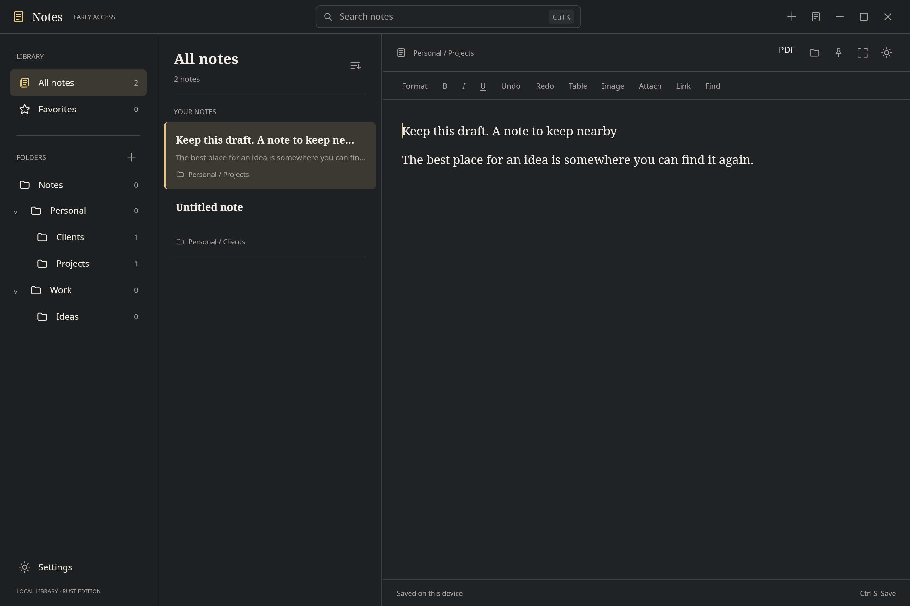

[Warm-paper creation](images/gpui-folders-light.png) ·
[Compact filing](images/gpui-folders-small.png) ·
[Recoverable naming error](images/gpui-folders-error.png)

Filing keeps your current text, caret and undo/redo history and returns you to
the editor. Existing rich documents and the Qt-compatible schema are preserved.
Folder deletion, Recently Deleted and keyboard tree navigation are available.
Drag-and-drop filing remains deferred; folder deletion Undo restores notes unfiled
rather than rebuilding the deleted folders. See
[ADR 0016](decisions/0016-folders-and-filing.md).

## Make yourself at home

Settings offers **Graphite**, **Warm paper** and **Your desktop**, with a live
Omarchy palette, plus **Serif**, **Sans** and **Mono** writing fonts. Change writing
size from 14–28 pixels without changing note content, undo history or PDF styling.
Open notes and Quick Note share your choices. Tab and Shift+Tab move through the
controls and scroll them into view; Escape returns to the previous focus.

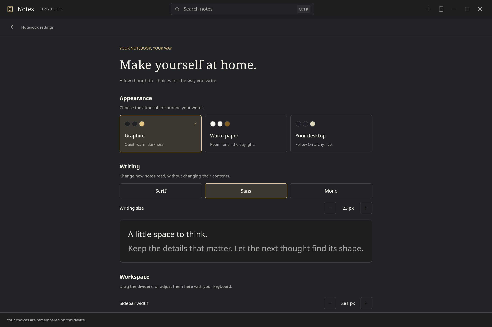

[Warm paper](images/gpui-settings-light.png) ·
[Compact keyboard navigation](images/gpui-settings-small.png) ·
[Recoverable preferences error](images/gpui-settings-error.png)

Drag pane dividers, or adjust their widths with the keyboard in Settings. Widths
save when the drag ends; Escape cancels the drag. Narrow windows adapt automatically.
Preferences live in `$XDG_CONFIG_HOME/omarchy-notes-gpui/preferences.json`, falling
back to `~/.config/omarchy-notes-gpui/preferences.json`. They apply across Rust
libraries and do not alter Qt settings. The demo does not save preferences.

The footer reports saving or a preferences error separately from note autosave.
Invalid or newer preference files remain untouched. **Try again** rereads the
file after a repair and merges the choices you changed. A graceful close waits
for an in-flight write; a reported preferences failure allows closing with those
choices unsaved. See [ADR 0015](decisions/0015-persistent-writing-preferences.md).

## Shape and find your words

Select text to reveal a small formatting toolbar near your words. It offers
**B**, **I**, **U**, **Highlight**, **Link** and **More**. **Ctrl+Shift+Space** gives
it keyboard focus; Tab explores the controls and Escape returns to writing.
It stays out of the selection, hides during dragging/composition and uses the
full Format panel when there isn't room. Escape or an outside click dismisses
it until you make another selection.

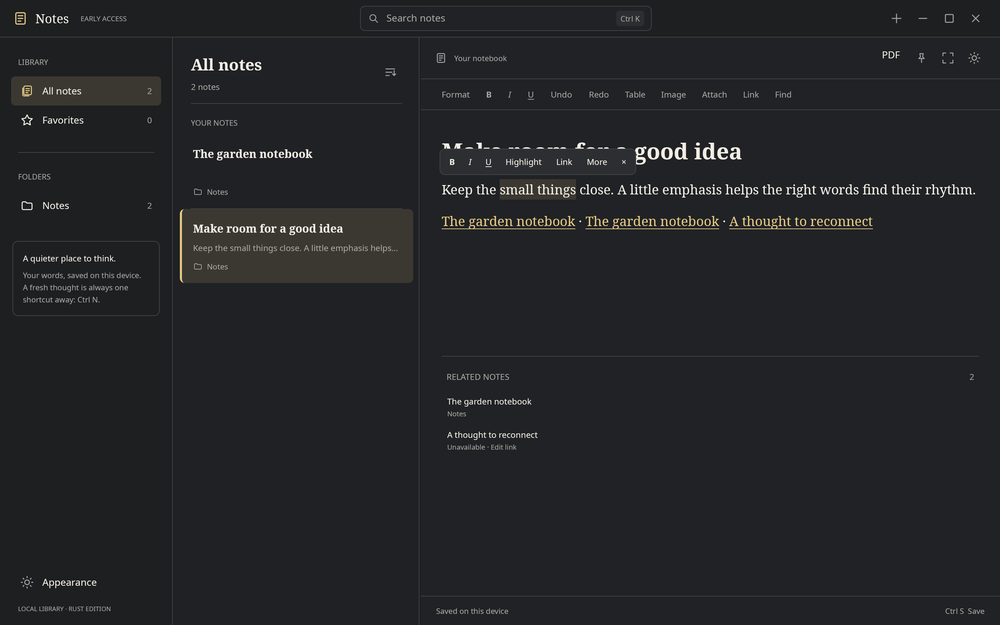

[Warm paper](images/gpui-selection-light.png) ·
[Compact selection toolbar](images/gpui-selection-narrow.png)

**Format** opens a compact panel for all six text marks, three heading levels,
body text, quotations and bulleted, numbered or check lists. List items also offer indent and
outdent. Tab explores the controls; Escape returns to your selection. Formatting
acts on selected text, or on the word when the caret is inside one. At a word
boundary it changes what you type next. Reapplying the current list style returns
it to body text. Mixed text marks expose a mixed accessible state.

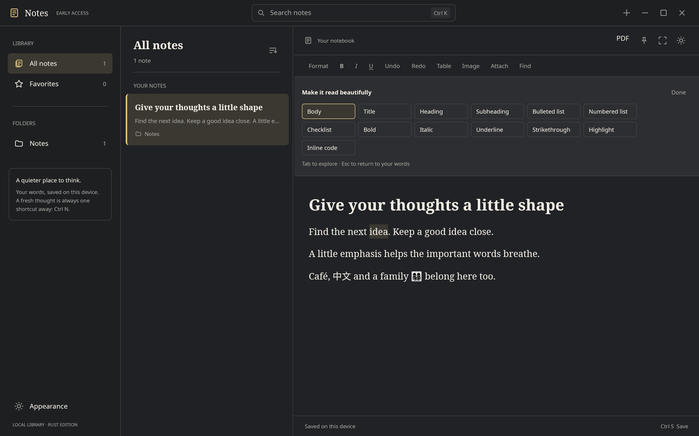

[Warm paper](images/gpui-format-light.png) · [Compact panel](images/gpui-format-narrow.png) ·
[Keyboard focus in a short window](images/gpui-format-small.png)

**Find** or **Ctrl+F** searches the current note. A short text selection seeds the
query. Matches are highlighted; the current match has a stronger tint and an
underline. Enter/F3 moves forward, Shift+Enter/Shift+F3 moves back, wrapping at
the ends. Escape returns to writing at the match. Editing refreshes the results
without moving your caret, saving a search, or adding undo steps.

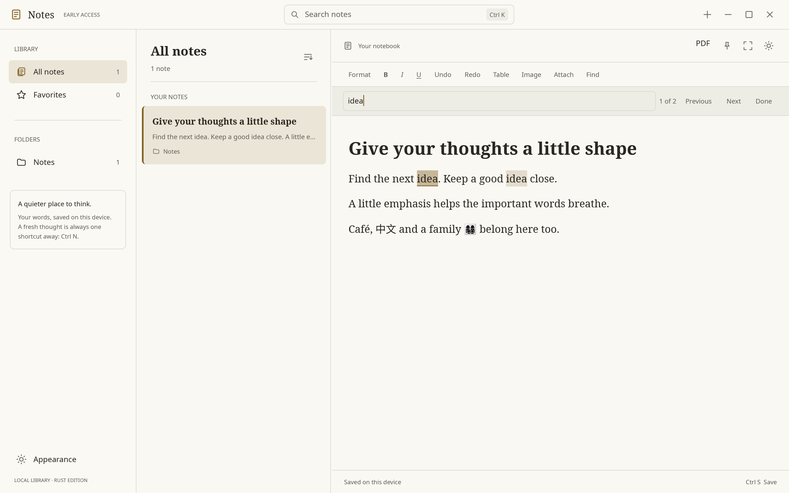

Find is literal, Unicode-aware and case-insensitive. It searches across style
runs within paragraphs and cells, including soft line breaks; it does not cross
paragraph/cell boundaries. It does not search attachment contents. Queries are
limited to 4 KiB and highlighted results to 100,000, with an explicit request to
narrow the search when that limit is reached. Regex syntax is treated as text.
Queries and matches remain local to each editor for this session. The global
library search is a separate field.

## Quotations with room to breathe

Choose **Format → Quote** or **Ctrl+Shift+Q** to give a passage a quiet gold rule
and a little more space. Its text, links and marks remain editable. Return
continues the quote; Return on an empty quote returns to ordinary prose.
Shift+Return adds a soft break. **Format → Body** changes it back; undo restores
the earlier structure. Quotations also work inside table cells.

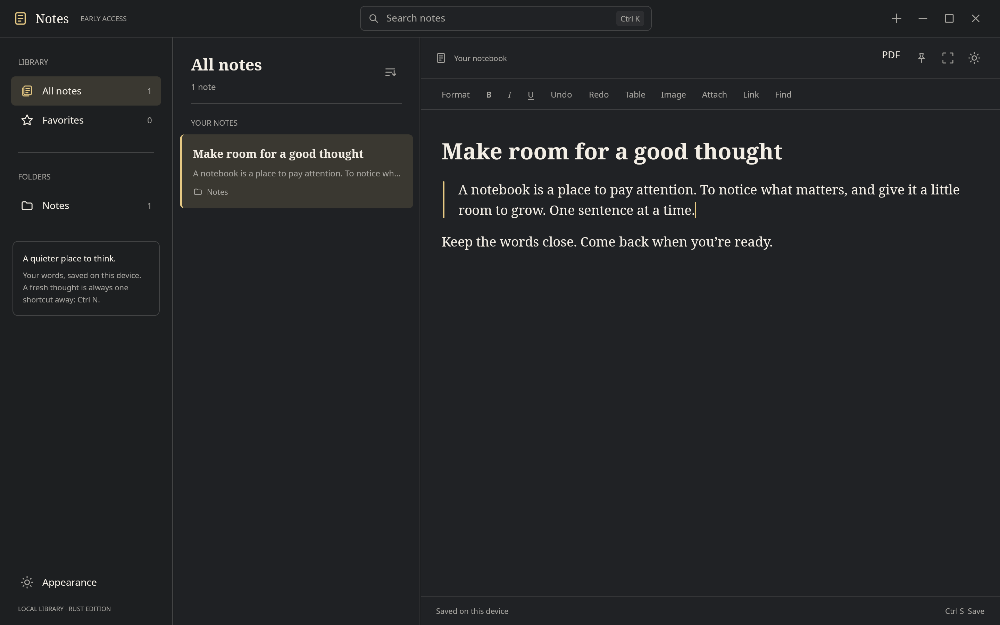

[Warm paper](images/gpui-quotes-light.png) ·
[Narrow window](images/gpui-quotes-narrow.png)

The first quotation needs a newer library format. Your draft stays in the editor
until you choose **Enable quotes…**, review the backup location and compatibility
notice, then choose **Back up & enable quotes**. The app copies and verifies the
entire saved library before changing its format. Current unsaved drafts are
retained in memory and save after the upgrade; the backup contains saved content.
Opening a library never silently enables the new format.

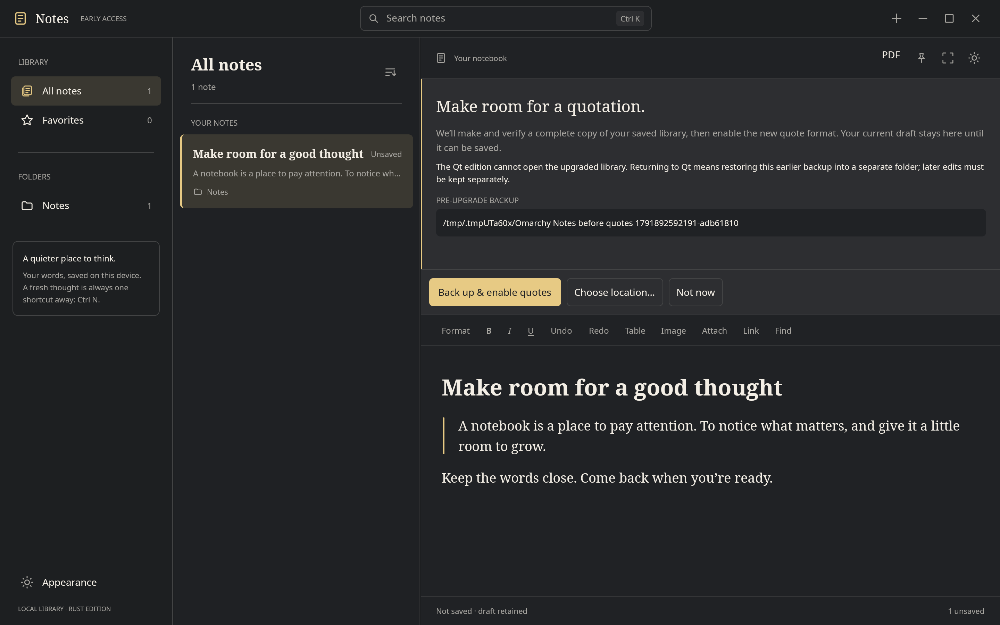

[Keyboard-accessible backup details in a short window](images/gpui-quote-upgrade-small.png)

**Not now** leaves the format unchanged. Undo the quote conversion to resume
compatible saving, or return to the upgrade later. Errors preserve your draft and
let you retry or choose a fresh destination. Cancellation is checked before the
format transaction commits; a completed backup is retained. Once committed,
cancellation cannot revert the upgrade. In a compact window, the actions stay
visible while the explanation scrolls; arrows, Page Up/Down and Home/End work
when the details have focus.

**The Qt edition cannot open an upgraded library.** To return to Qt, restore the
pre-upgrade backup into a **new directory** using the backup commands below, and
open that restored directory with Qt. Keep a separate backup of later Rust edits;
restoring the earlier backup does not include them. The upgrade records the backup
path and database digest, but cannot protect a backup that is later moved or deleted.

JSON and rich clipboard preserve quotation blocks. HTML uses `blockquote`, and
the Markdown conversion backend uses `>`. Pasting a quote into prose keeps its
boundaries; nested HTML/Markdown quotes flatten with an explicit warning. PDF
preserves the inset rule across page breaks. Reviewed Markdown/text file import
and portable Markdown/HTML exports with assets are available through Settings;
see [data ownership](rust-data-ownership.md).

## Connect a thought

Select some words and choose **Link** or **Ctrl+Shift+K**. Enter a complete
`https://`, `http://` or `mailto:` address. Your words and formatting stay intact.
**A note** or **Ctrl+L** opens a searchable note chooser; use arrows and Enter to
choose, or click a result. With no selection, a new link inserts the destination
address or note title. Escape closes the panel and returns to writing.

Place the caret in a link to see **Open**, **Edit** and **Remove**. Removal keeps
the text. **Ctrl+Enter** or **Ctrl+click** follows the link. Note links open inside
this library; the header's return arrow takes you back with your editor state
preserved. Missing targets keep you in your current note with a clear explanation.
External links open through your desktop's default application only on activation.
An existing link can also be removed from its editing panel with the keyboard.

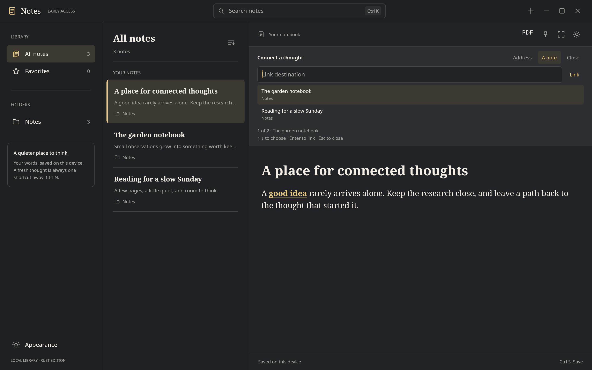

[Warm paper](images/gpui-links-light.png) ·
[Address entry at 420 pixels](images/gpui-links-narrow.png) ·
[Short-window chooser](images/gpui-links-small.png)

Link edits participate in undo and compatible saving. Open dialogs refuse to
apply to a changed document or selection. Legacy destinations that cannot be
activated remain editable/removable. Return history is local to this session.

**Related notes** appears below documents with explicit links to other notes.
Each target appears once, using its current title and folder. **Ctrl+Shift+R**
brings the summary into view; arrows choose a target and Enter opens it. Escape
returns to your writing. An unavailable target offers **Edit link**, which reveals
the original words and lets you reconnect or remove the link. These are explicit
outgoing links, not suggestions or a backlinks index.

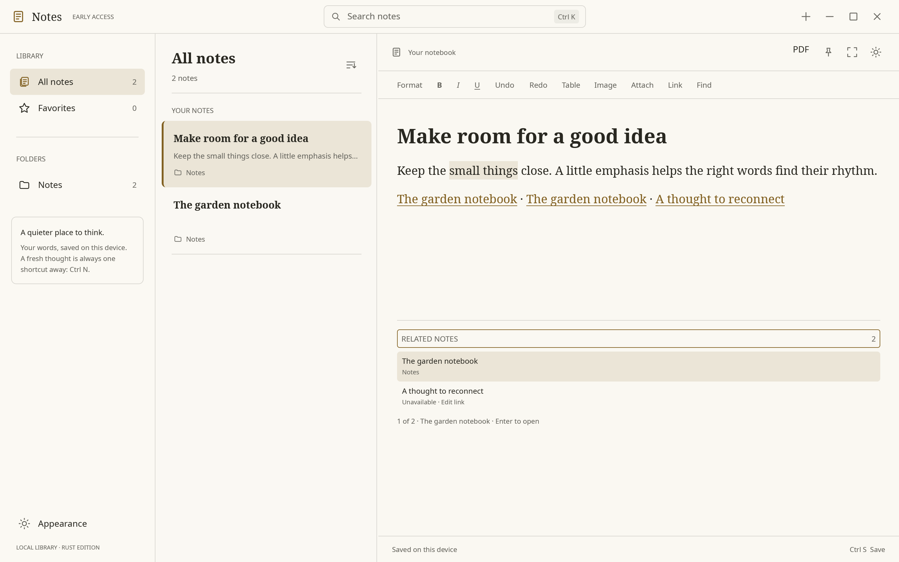

[Short-window keyboard navigation](images/gpui-related-small.png)

## A little structure

Choose **Table** or press **Ctrl+Alt+T** to insert a 2 × 2 table after the current
paragraph. Start typing immediately. Tab selects the next cell's content, so you
can replace it in one step; Tab from the final cell adds a row. Shift+Tab moves
back. **After table** or **Ctrl+Shift+Enter** returns to ordinary writing.

While inside a table, **Table** opens a compact **Shape this table** panel. Add
rows above/below or columns before/after, delete a row/column, split an existing
merged cell, or remove the table. Only applicable actions appear. Tab moves
through the options, scrolling the focused control into view in short windows;
Escape or Done returns to the caret. Structural edits are individual undo steps.
Deleting rows/columns removes their contents; Ctrl+Z restores them.

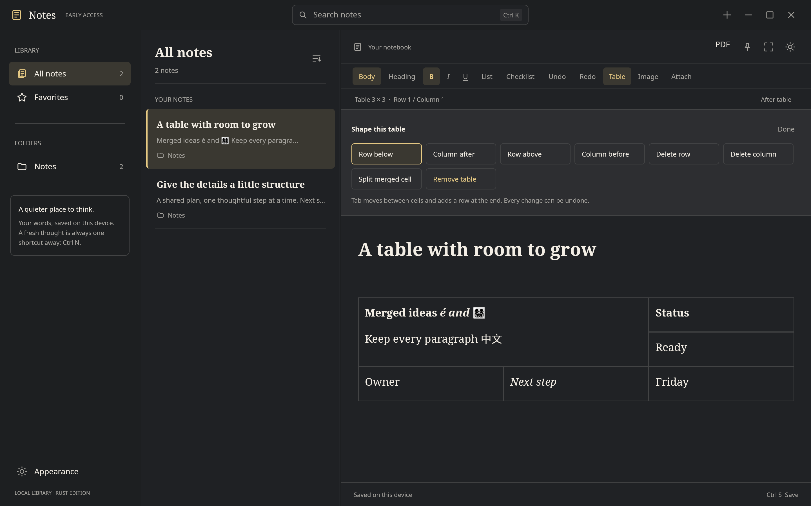

[Warm paper](images/gpui-table-light.png) · [Compact window](images/gpui-table-narrow.png) ·
[Keyboard focus in a short window](images/gpui-table-small.png)

Edits preserve merged cells, surviving block identities and rich text. Inserting
through an existing merge expands it; deleting one covered row/column shrinks it
without losing the cell's content until the whole cell is removed. Splitting
keeps its content in the top-left cell. Qt editable-document round trips verify
the stored table structure. Creation of new merges, per-table horizontal scrolling
and full accessible table navigation remain pending. Limits are 1,000 rows and
64 columns; these are validation bounds, not performance guarantees.

## Pictures, files and clipboard

Choose **Image** or **Attach** in the toolbar, drop local files on the editor,
or paste files copied from a file manager. PNG, JPEG, WebP and GIF images appear
inline; GIF previews show the first frame. Other files appear as quiet cards
with a filename, file type and size. Click an object to select it. **Open**,
**Save as…** and **Remove** appear only for a single selected object; removal is
undoable. Double-click also opens it. Open prepares a private, non-executable
copy for the default application; unsupported executable/active file types
require saving explicitly first. Save as requires a new filename.

Files are stored before the editor inserts their references. If you keep typing
or move the cursor during import, **Insert here** lets you choose where the
result belongs. **Cancel** ignores a late insertion. Errors retain the draft;
missing/corrupt media has a clear unavailable state and **Reload file** action.
Finish or cancel a pending insertion before closing or exporting recovery.

Limits are 1–16 files and 32 MiB of combined file data per import/copy/paste;
images are capped at 24 megapixels and 12,000 pixels per side. Preview frames
fit within 1,400 × 1,000 pixels with a 48 MiB retained preview budget for the
selected editor. Switching notes releases the previous note's preview frames.
Original bytes remain unchanged. Imported files and private `opened/` copies
are currently retained; garbage collection/cache cleanup is still pending.

On Wayland compositors offering **WLR data-control** (verified on Hyprland),
copy offers Notes JSON, HTML and plain text together. A lone selected image also
offers its original image MIME/bytes. Rich paste retains supported headings,
marks, links, lists, tables, images and attachments. Between current app instances,
media travels with the selection, including across separate libraries;
attachment IDs are reassigned to the destination note. Clipboard ownership
lasts while the process is running unless the desktop clipboard manager retains it.
The app only requests content on Paste; it keeps no clipboard history.

HTML import converts a bounded, inert subset into note blocks. Scripts and
embedded active content are omitted, unsupported links are stripped, and
remote/data/local HTML images are replaced by alt text with a notice. Paste
actual image data or attach its file to retain the picture. Custom fonts, CSS
layout and every browser-specific HTML convention are not preserved. HTML input
is limited to 4 MiB; individual clipboard representations to 48 MiB.
**Ctrl+Shift+V** remains available for plain text.

Document-schema-1 custom JSON stays readable by Qt. Schema-2 copies from the
quote-capable format require Rust; use plain text when pasting them into Qt.
Qt does not consume the new portable
asset bundle: **cross-library media clipboard exchange with Qt is not supported**.
Qt-origin media can be pasted only when its referenced assets already exist
in the receiving Rust library; missing references are refused. External HTML
and the custom format are tested as transport/conversion, not as a full office-
suite fidelity guarantee.

On desktops without WLR data-control, the UI explains the limitation: GPUI
provides external plain text and rich copies within the same window. Media in
those local copies goes through the storage importer too. X11 rich MIME and
other Wayland clipboard protocols remain pending.

Headless capture, help and version do not initialize a window or GPU:

```sh
printf 'A thought to keep\nSome details.' | omarchy-notes-rust --capture -
```

Capture now also works while the Rust app owns that library. The note appears in
the library without moving your caret or replacing the note you're writing. The
CLI prints **Saved note** only after the transaction commits. Empty/whitespace-only
input is rejected; other spacing is preserved, with line endings normalized.

Every capture prints a request UUID before dispatch. Keep that ID if a command
loses its reply. **`--capture-status UUID`** checks the committed receipt without
changing the library. **`--capture TEXT --request-id UUID`** retries the original
text safely: it returns the same note ID without creating a duplicate. A new
capture needs a fresh ID; using an existing ID with different text is an error.
IDs must be lowercase UUIDs. The default generated ID is enough for ordinary use.

A missing status result is not proof that an in-flight request cannot finish.
Keep the same ID when retrying. A receipt describes the original capture, even if
you later edit or delete the note; retrying does not undo those changes. Receipts
travel with full backups, and restoring an older backup restores its earlier
receipt set. They do not deduplicate across unrelated libraries.

Only the Rust instance protocol supplies durable replies. If Qt owns this
library, close it before capturing with Rust. `--simulate-save-failure` configures the owning
process at launch; a second invocation cannot change a running owner's mode.

## A small window for a thought

Use **Ctrl+Shift+N** or the notebook icon beside New Note to open Quick Note.
Start directly in its compact writing window, or reach the existing Quick Note:

```sh
cargo run --release --locked -p omarchy-notes-preview --bin omarchy-notes-rust -- --reference --quick-note
```

Quick Note has the same rich formatting, images, files and clipboard as the main
editor. It shares the library's writer, so the main window can close while you
keep writing. **Open in Notes / Ctrl+Shift+O** moves the existing editor into
the notebook, preserving selection and undo/redo; it opens the main window if
needed. Finish any composition or pending insertion before moving the note.
**Ctrl+Enter** still opens a selected attachment.

**Ctrl+W** saves and closes Quick Note. Closing it untouched leaves no database
note. Opening that untouched note in Notes deliberately keeps it. Save errors
leave the window and draft intact: retry or open the main recovery tools.

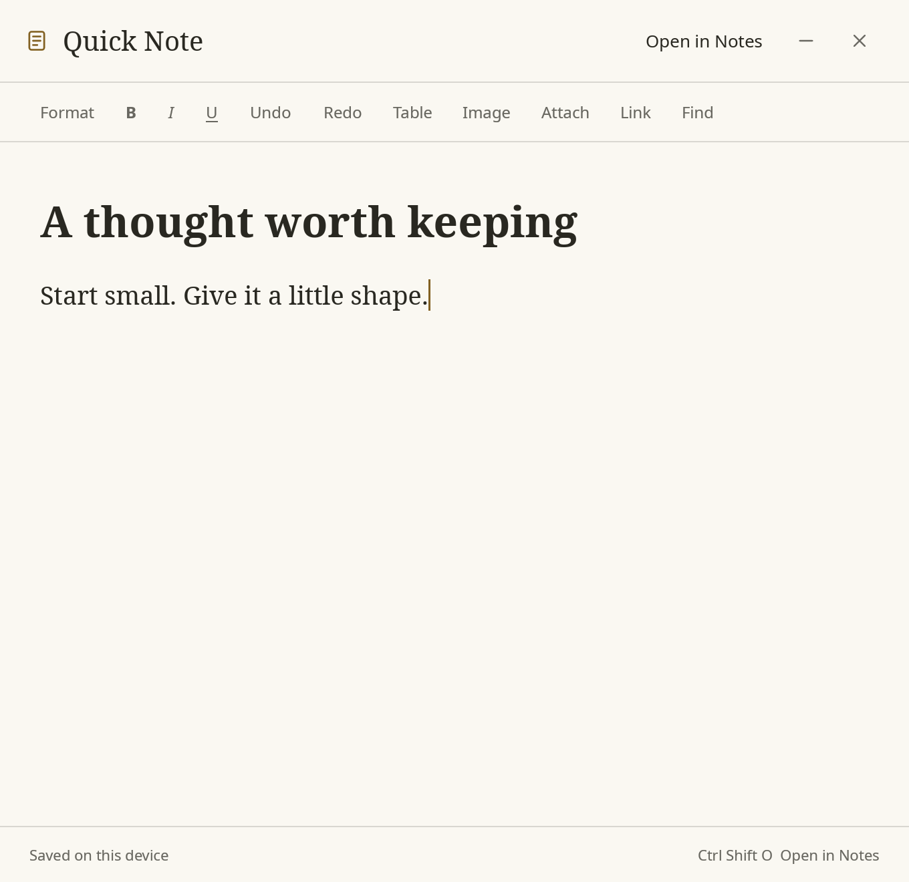

Opening a second `--quick-note` process against an already open library
reuses the existing Quick Note and preserves its draft. See
[the shared-session decision](decisions/0013-shared-quick-note-sessions.md).

## Open the window you need

Ordinary startup opens or requests activation of the library's main window.
It preserves the current note and caret. These options work at startup and when
that Rust library is already open:

```sh
omarchy-notes-rust --new
omarchy-notes-rust --note NOTE_UUID
omarchy-notes-rust --quick-note
```

Add `--data-dir PATH` when using a different library. `--new` creates and opens
one note; a forwarded reply waits for its committed creation. `--note` selects
an existing lowercase UUID, or explains that it is unavailable without changing
your current note. Opening a Quick Note's ID in the main window moves its existing
editor, including selection and undo. Finish a composition or pending insertion
before moving it. A default launch can reopen main while Quick Note keeps running.

A second invocation forwards before GPU startup, so it can run without DISPLAY
or WAYLAND_DISPLAY when the owner is already running. Appearance/failure settings
belong to the owning process; another invocation does not change them.
Window requests use **Opened**, separate from capture's durable **Saved**.
Quick Note's blank draft is still only in memory until you edit or explicitly keep it.

`XDG_ACTIVATION_TOKEN` is forwarded to the requested Wayland surface without
changing the owner's environment. The desktop decides whether to grant focus;
an opened-window reply does not guarantee focus. An unsupported token path leaves
the window available and explains how to select it. There is no compositor focus
override. Native checks cover correct token destinations and invalid-token refusal;
the broader valid-token, X11 and desktop focus-policy matrix is still pending.

If a request loses its reply, check the app before repeating `--new`: it may have
finished. The client never starts a second writer or automatically repeats an
ambiguous request. Recent identical protocol IDs are deduplicated within a running
owner (128 retained outcomes); this is not capture's durable retry/status contract.
See [the launch decision](decisions/0014-window-launch-forwarding.md).

## Storage and recovery

By default the writer retains Qt database schema **2** and rich-document schema
**1**. The explicit quote upgrade moves the library to database schema **3**;
subsequent writes use rich-document schema **2**. Earlier bodies and history are
left unchanged until edited. Schema-1 databases migrate transactionally to schema
2 without opting into quotes. Block IDs, marks, links,
table cells and image/attachment references survive loading and saving. Derived
text, title, snippet, tags, media references and FTS indexes update with each
transaction. Revision history is recorded at the Qt-compatible interval; a
history browser is not implemented. Unsupported database/document versions are
refused, and invalid active notes fail startup rather than loading as empty text.

There is one background writer with a bounded queue, WAL and `synchronous=FULL`.
Older acknowledgments never mark newer edits saved. A revision conflict retains
the draft and offers **Save a copy**. Other failures retain the draft and offer
**Retry** or **Export drafts**. Normal window close and Ctrl+Q wait for committed
edits and remain open on failure. Finish or cancel composition before closing.
Unacknowledged edits are in memory; forced termination can lose those edits.

Export drafts writes a new recovery directory containing `recovery.json` and
hash-verified referenced blobs. It includes the exact unsaved document bodies,
note metadata and attachment records. **Close with recovery saved** appears only
when the exported revisions still cover all current dirty drafts. This is a
recovery bundle, not a Qt backup; a recovery import UI is still pending. Retain
the complete directory for recovery tooling. Missing/corrupt assets fail export
without claiming success. Partial output directories should be inspected, not
regarded as completed exports.

To inspect failure behavior, reopen a scratch library containing a saved note
with `--simulate-save-failure`, edit it, then try saving/closing. The flag also
blocks creation. Never use your only copy of a library for fault testing.

### Full-library backups and safe restore

Close the writer using the source library, then use the Rust app's headless
commands. The destination's parent must exist; its final folder must be new.

```sh
# Replace the example paths with your library, backup and recovery locations.
omarchy-notes-rust --data-dir /path/to/library --backup /path/to/new-backup
omarchy-notes-rust --inspect-backup /path/to/new-backup
omarchy-notes-rust --restore /path/to/new-backup --data-dir /path/to/new-restored-library
omarchy-notes-rust --data-dir /path/to/new-restored-library --reference
```

These commands need no display or running app. Backup takes the shared library
lock, snapshots SQLite consistently, and preserves all database tables and
registered blobs, including trash, revision history, folders and Smart Folders.
It checks document/media references, foreign keys, the copied search index and
blob sizes/hashes before acknowledging success. Assets are copied as streams,
including legacy assets larger than the editor's 32 MiB import limit.

The completed directory uses Qt backup **format 1**: `manifest.json`, a standalone
`library.sqlite3`, and `blobs/`. New manifests include an optional database SHA-256;
Qt-created manifests without it remain readable. Inspection checks database
integrity, supported document versions, references, manifest counts and all blob
hashes without changing the backup. Search-index integrity is additionally checked
when creating or restoring a backup. SHA-256 detects corruption, not authenticity.

Backup and restore build privately, sync their files/directories and publish
atomically without replacing any existing path. **Restore requires a new explicit
`--data-dir`; it never replaces your current notes.** Open that restored copy to
review it. The original backup remains unchanged. Restoring an earlier backup
returns its earlier contents; retain any later edits in a separate backup first.
Schema-1 sources/backups stay schema 1 during these commands; opening the restored
library performs the normal schema-2 migration.

Failures before publication leave no destination. A killed process may leave an
unpublished hidden `.omarchy-notes-<id>.partial` directory beside it. Never treat
such a directory as a completed backup. An error syncing the parent after
publication preserves the completed destination and names it for inspection.
The commands refuse missing/damaged assets and unsupported future formats.

Historical Qt backup creation → Rust restore and Rust backup → Qt inspection/open
passed in the scratch-library oracle. SIGKILL tests cover snapshot, blob, manifest
and publication boundaries; injected write failures cover ENOSPC paths. Physical
disk-full, sudden power loss, network filesystems and production-scale timing are
not verified. The quote-upgrade panel uses this backup path with progress and
cancellation. General in-app backup/restore and Settings routes are now available;
see [data ownership](rust-data-ownership.md).
Schema-3 backups restore in Rust. Historical cross-edition checks verified that
Qt rejected them and could reopen the restored pre-upgrade schema-2 backup; see
[ADR 0011](decisions/0011-backups-and-quote-migration.md). Current regressions use
Rust and frozen legacy fixtures; the live Qt oracle has been retired.

## A page worth sharing

Click **PDF** in the note header or press **Ctrl+Shift+P**. Choose **US Letter**
or **A4**, then **Export PDF…** and a new filename in the native save dialog.
The PDF uses a white page, generous margins, serif prose, restrained gold links,
quiet headers and page numbers. **Open PDF** opens the completed copy in your
chosen desktop viewer. Escape closes the panel or requests export cancellation.

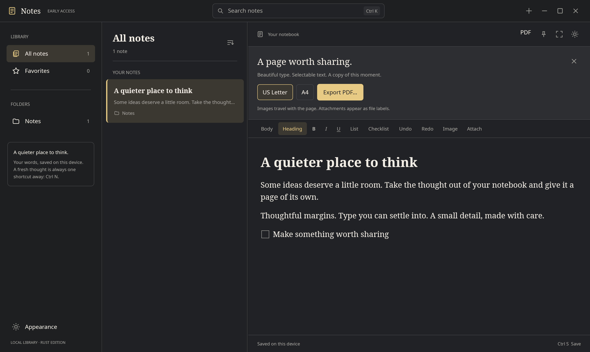

[Warm paper](images/gpui-pdf-light.png) · [Compact panel](images/gpui-pdf-narrow.png) · [Short window](images/gpui-pdf-small.png) ·
[Printed page](images/pdf-planning-page.png)

Export captures the current committed editor text when you choose **Export PDF…**,
including unsaved edits. Finish IME composition or file insertion first. Keep
writing or switch notes while it renders; the completion message names the
original note and tells you if newer edits need another export. PDF export does
not acknowledge an autosave or replace the recovery bundle. Close waits for an
active export to finish or be cancelled; existing destination files are never
overwritten. Only a finished, synced file is published at the destination.

Text stays selectable, fonts are embedded, supported marks and lists print,
and HTTP(S)/email links remain clickable. Internal note links print their labels.
Images preserve their proportions; GIF uses its first frame. Attachment names,
types and sizes print as labels; **attached file contents are not embedded**.
Missing/corrupt assets or missing glyphs fail with an actionable message.

Tables preserve horizontal/vertical merges. Their first row repeats after a
page break when it is independent of vertical merges. Long unmerged body rows
split at text-line/object boundaries. Nested tables, more than eight columns,
overlapping cells and merged rows taller than a page currently require simplifying
the note before export; these cases fail explicitly rather than dropping content.
PDF/A, fully tagged accessible PDFs, custom margins and print-dialog integration
are not implemented. The export panel's paper choice is session-local.

The Qt-free backend uses Cairo and Pango. Installed fonts provide language
fallback; the UI's embedded fonts are not automatically registered with the PDF
font system. Limits: 4 MiB text, 512 KiB per paragraph, 10,000 paragraphs,
100,000 styled spans, 500 pages, 64 MiB retained image rasters and 128 MiB output.
Images are downsampled to at most 2,400 × 2,400 pixels for export; stored originals
remain unchanged. Decoder limits match import. These are resource bounds, not
large-document performance guarantees.

## Remaining work

New table merges and advanced table operations, tags/Smart Folder interfaces,
gallery and library-wide attachment browsing, drag filing, bulk organization and
browsable revision history remain deferred. Trash, folder deletion, prefix search
with snippets, reviewed imports, portable exports and in-app backup/restore are
implemented. Editor retention and layout have bounded implementations and measured
CPU budgets; broader native fairness/performance acceptance remains follow-up.

The input adapter implements UTF-16 ranges, marked text and caret geometry.
Release checks recorded actual CJK composition and silent Orca processing, but
**complete human accessibility usability is unverified**. The native Unicode
editing/undo test stopped on stale accessible node traversal; see the
[release notes](rust-release-notes.md) for the evidence boundary.
The installed AT-SPI client reports cache-signature warnings and can retain
closed-window nodes; the multi-window oracle explicitly selects the active
window's accessibility frame. Screen-reader behavior across handoff still needs
real verification.
The rich editor now exposes AT-SPI text, caret, selection, character bounds,
formatting attributes, named images/files and actionable checklist states.
A native API check verifies accessible selection followed by keyboard editing,
undo and durable save, including Unicode and offscreen content. Search also
exposes text, caret and selection, and its query/result flow passes the native
check. This is not an Orca usability pass; heading/table navigation and RTL
geometry need deeper coverage.
The pinned Linux AccessKit adapter exposes `Text`, but not AT-SPI `EditableText`;
editing uses the keyboard after accessible caret/selection changes.
X11 runtime, mixed-DPI, suspend/resume and long-session behavior remain unverified.
These were open M2 gates. Rust is now the installer default, but retirement does
not establish that these checks passed; consult the current release evidence.

## Development checks

```sh
cargo test --workspace --locked
cargo clippy --workspace --all-targets --all-features --locked -- -D warnings
cargo fmt --all --check
cargo run -p notes-ui --example writing-check --features visual-tests -- target/writing-check
cargo run -p notes-ui --example media-check --features visual-tests -- target/media-check
cargo run -p notes-ui --example table-check --features visual-tests -- target/table-check
cargo run -p notes-ui --example writing-tools-check --features visual-tests -- target/writing-tools-check
cargo run -p notes-ui --example link-check --features visual-tests -- target/link-check
cargo run -p notes-ui --example context-check --features visual-tests -- target/context-check
cargo run -p notes-ui --example quote-check --features visual-tests -- target/quote-check
cargo build -p notes-storage --example table-roundtrip --locked
python tests/test-rust-tables.py target/debug/examples/table-roundtrip
cargo run -p notes-ui --example visual-check --features visual-tests -- target/visual-check
cargo run -p notes-ui --example settings-check --features visual-tests -- target/settings-check
cargo run -p notes-ui --example organization-check --features visual-tests -- target/organization-check
cargo run -p notes-ui --example pdf-ui-check --features visual-tests -- target/pdf-ui-check
# PDF checks also require Poppler and qpdf; --output must name a new directory:
cargo build -p notes-export --example pdf-check --locked
python tests/test-rust-pdf.py target/debug/examples/pdf-check --output target/pdf-review
# Durable capture and local Unix IPC, with no graphical session:
cargo build --release -p omarchy-notes-preview --bin omarchy-notes-rust --locked
cargo build -p notes-platform --example instance-owner --locked
python tests/test-rust-capture.py target/release/omarchy-notes-rust target/debug/examples/instance-owner
```

The writing harness routes real GPUI input through the rich editor and storage
worker, then reopens SQLite. It covers formatting, composition/Enter, in-process
rich clipboard, table edits, per-note undo, late save acknowledgments, save
failure, close guards and recovery export. GPU renders use real fonts in isolated
windows and never capture desktop content. The durability test kills a separate
writer after acknowledged commits and verifies every acknowledged note on reopen.
The media harness imports images/files through the real writer queue, checks
cached image rendering, removal/undo, stale-cursor confirmation, cancellation,
failed import and compact reopen. Storage tests also verify exact portable bytes,
remapped ownership, corrupt/missing files, size limits and nonblocking rejection
of special files. Historical legacy migration oracles used the actual Qt document
reader and `QLockFile` APIs against scratch copies to check both lock directions
and unchanged blob hashes. Those results are migration evidence, not Qt support.

For opt-in desktop clipboard/input checks (Hyprland, `wtype`, `wl-clipboard`):

```sh
cargo build -p notes-clipboard --example clipboard-probe --locked
python tests/test-rust-clipboard.py
python tests/test-rust-media-native.py
# No clipboard access; checks the export shortcut and return to writing:
python tests/test-rust-pdf-native.py
# Requires python-gobject, at-spi2-core and dbus-run-session; uses a private bus:
python tests/test-rust-accessibility-native.py
# Separate windows, exact-caret/undo handoff, close/reopen and shared saving:
python tests/test-rust-quick-note-native.py
# Real CLI forwarding and guarded Wayland activation/close/reopen:
python tests/test-rust-launch-native.py
# Simultaneous first launches and creation failures, with no desktop input:
python tests/test-rust-launch-startup.py
# Disposable XDG config; keyboard settings, retained undo, reopen and retry:
python tests/test-rust-settings-native.py
# Scratch library/config; nested folders, filing, caret/undo and error retry:
python tests/test-rust-organization-native.py
```

The Quick Note GPU workflow can also run without desktop input:

```sh
cargo run --release -p notes-ui --features visual-tests --example quick-note-check
cargo run --release -p notes-ui --features visual-tests --example window-launch-check
```

The two clipboard/media checks replace the clipboard with test content. The native workflow uses the
release binary, two disposable libraries, exact-window guarded input and cleanup
of every launched process. Portal picker interaction, desktop drag/drop delivery,
launching an external viewer and clipboard-manager persistence still need manual
verification; the import/export functions themselves have automated coverage.

The accessibility check uses a private D-Bus session, disposable settings and a
copied library. It verifies real AT-SPI registration, Unicode text/selection,
formatting, character hit testing, checkbox actions, media names, saved edits and
search query replacement with the expected filtered results. It also creates and
edits a table, appends a row through Tab, checks contextual actions, undoes
structural changes and verifies the saved cell contents.
It also cancels and completes the explicit quote upgrade, checks the verified
pre-upgrade backup and saved quotation, then undoes formatting without losing marks.
Forwarded CLI capture must appear without changing the open note or its focus,
and repeating the request must not create another note. The native tests clean
up their exact owned IPC socket after terminating a test process.
It guards every keyboard event against the exact owned process/window/workspace
and closes its app and registry. It does not change desktop accessibility settings.

See the [verification record](../llm-docs/gpui-rebuild-baseline.md),
[storage decision](decisions/0003-compatible-rich-writing.md),
[media/clipboard decision](decisions/0004-media-and-rich-clipboard.md),
[PDF decision](decisions/0005-qt-free-pdf-export.md),
[accessibility decision](decisions/0006-accessible-rich-text.md),
[table editing decision](decisions/0007-compatible-table-editing.md),
[writing tools decision](decisions/0008-writing-tools-and-find.md),
[preferences decision](decisions/0015-persistent-writing-preferences.md),
[folder organization decision](decisions/0016-folders-and-filing.md), and
[rebuild plan](../llm-docs/rust-gpui-rebuild-plan.md).
