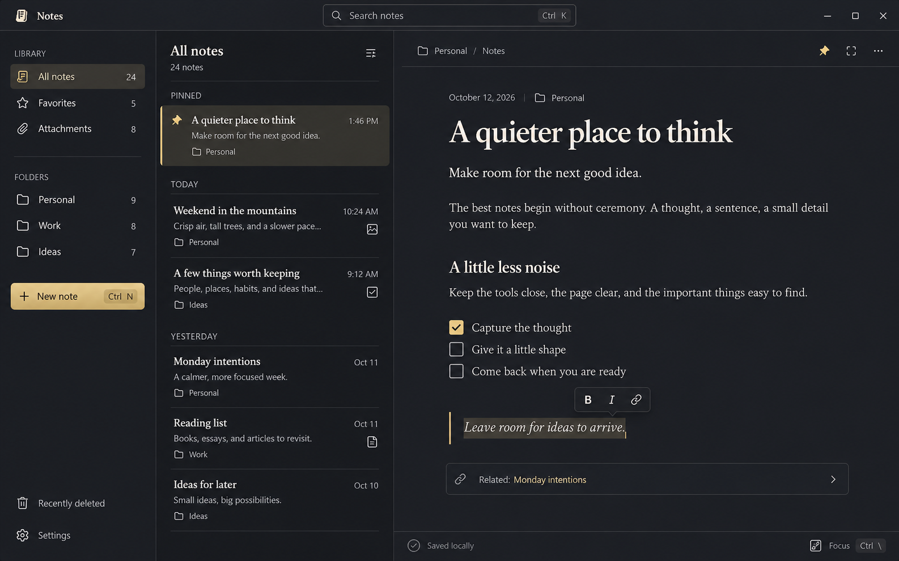

# Omarchy Notes — Rust / GPUI rebuild plan

Status: implementation in progress (rich writing, capture/Quick Note, preferences and folder organization increments available; feasibility, library parity and full-port gates remain open). Updated 13 October 2026.

The [focused Rust v1.0 release push](rust-v1-release-plan.md) defines the next
delivery milestone: a complete everyday notes workflow with explicit feature
deferrals and unchanged quality requirements. It does not replace this full-port
backlog or authorize treating the entire rebuild as complete.

Rebuild Omarchy Notes as a native Rust/GPUI application that realizes the generated design below while preserving the existing app's rich editing, local library, portability and Omarchy integration. The result must be **beautiful, calm, responsive and a real delight to use**. These are release requirements, equal in importance to correct editing and trustworthy saving; they are not a final coat of styling.

This document defines the full rebuild. A separate Rust/GPUI edition now creates, edits, autosaves and reopens compatible rich notes; see the [implementation checklist](gpui-rebuild-baseline.md) and [preview guide](../docs/gpui-preview.md) for verified progress and remaining work. The current Qt app remains the supported application until the replacement passes the gates below.

## 1. The design we are building



The [full-resolution reference](assets/gpui-notes-design.png) is the visual north star. Implement its hierarchy, proportions, typography, restraint and interaction intent. Its sample notes, counts and dates are illustrative data. Scale the design to real windows and real content rather than copying the image as a fixed canvas.

The product promise is: **a quieter place to think, where capturing, shaping and finding a thought feels effortless.**

### Required visual character

- Layered, opaque graphite surfaces with warm, readable text. The document must remain legible regardless of the wallpaper behind the window.
- A compact global header, a calm library sidebar, an editorial note list and a generous writing surface. Content receives the strongest visual emphasis.
- Expressive serif titles and prose paired with crisp sans-serif navigation, metadata and controls. Typography must still work for long titles, mixed scripts, emoji and user font preferences.
- Restrained champagne accents for selection, the primary action, checked items and links in the reference theme. Other Omarchy themes retain their own accent through the same semantic system.
- Fine dividers, consistent line icons, disciplined spacing and subtle surface changes. Avoid heavy borders, repetitive cards around ordinary text and decorative visual noise.
- Contextual formatting close to the selection, with a discoverable keyboard and menu route to every command. The persistent formatting strip in the current app gives way to a quiet document header.
- Carefully finished secondary surfaces: search, menus, dialogs, Quick Note, Settings, empty states, errors and recovery must feel like parts of the same product.

### Beauty and delight are acceptance criteria

Every feature is complete only when it has correct behavior, polished appearance, keyboard access, accessible semantics and appropriate feedback. A functioning but visually unfinished feature does not pass its milestone.

| Requirement | Evidence required before release |
|---|---|
| The app clearly realizes the reference | Side-by-side native screenshots using the reference fixture; review composition, typography, spacing, selected states and editor chrome at the same viewport. Record and resolve material deviations. |
| Writing feels immediate | New Note places the caret immediately; typing, selection, scrolling and undo meet the performance budgets in section 9. No animated layout shifts beneath the caret. |
| The app feels composed in every state | Review the state matrix in section 10, including empty, loading, long content, failed saves and missing attachments. No unstyled fallback dialogs or unexplained blank panes. |
| Common actions feel effortless | In a first-use check with at least five people, at least four complete each core task without hints: create and format a note, organize it, find it again, open an attachment and recover a deleted note. Any data-loss or keyboard trap blocks release regardless of the score. |
| Beauty survives accessibility preferences | Readable light/dark themes, visible keyboard focus, reduced motion, increased text size and tested display scaling; no essential control available only on hover. |
| Feedback builds trust | Saved means committed; failed operations retain work and explain the next action. Routine successful saves do not produce repeated toasts. |
| The experience invites daily use | A five-working-day trial records friction in capture, editing, retrieval and recovery. Resolve all severe issues and repeated everyday annoyances before replacing Qt. |

Each milestone produces a short evidence record: screenshots, observed interactions, measurements, unresolved defects and the next correction pass. Visual review happens throughout the rebuild. Pixel diffs are useful for regressions; they do not replace human judgment about beauty and usability.

## 2. Scope and the existing contract

The first replacement release targets Arch Linux / Omarchy with native Wayland. Preserve X11 compatibility if the existing distribution supports it, and test it before advertising it. macOS, Windows, cloud sync, collaboration, AI features, OCR and encryption are separate projects. The app remains useful entirely offline, without an account or required network service.

The current application is Qt Quick/QML and C++20. Read the implementation and its tests as the behavioral baseline, particularly where old planning documents have become stale.

| Area | Existing behavior to carry forward | Primary reference |
|---|---|---|
| Rich documents | Heading levels, text marks, nested bullet/number/check lists, tables including merged cells, images, attachment objects, note links, undo/redo and structured clipboard | `src/core/RichDocument.*`, `src/core/DocumentConverter.*`, `src/app/EditorController.*`, `tests/tst_document.cpp`, `tests/tst_editor.cpp` |
| Library | Nested folders, move/duplicate, pins, sort modes, tags, Smart Folders, list/gallery, attachment browser and 30-day trash | `src/core/NoteStore.*`, `src/app/qml/`, `tests/tst_store.cpp` |
| Finding notes | SQLite FTS5 prefix matching and snippets; in-note find with next/previous navigation | `src/core/NoteStore.cpp`, `src/app/EditorController.cpp` |
| Durability | Revision-checked saves, history, WAL/FULL, staged content-addressed blobs, failure recovery, consistent backup and safe restore | `src/core/LibraryService.*`, `src/core/BlobStore.*`, `src/core/LibraryBackup.*`, `tests/tst_store.cpp` |
| Interchange | Markdown/text and folder import; Markdown/HTML/PDF and whole-library Markdown export; explicit warnings about unsupported content | `src/core/NoteExchange.*`, `tests/tst_exchange.cpp`, `docs/migrating.md` |
| Desktop | Single library owner, launch forwarding, Quick Note, CLI capture, app identity, live theme changes and optional Hyprland setup | `src/app/main.cpp`, `src/app/InstanceChannel.*`, `src/app/HyprlandSetup.*`, `tests/tst_launch.cpp`, `tests/tst_theme.cpp` |
| Distribution | Arch package, desktop entries, icons, man page, AppStream metadata, attractive terminal installer, checksums and release automation | `install.sh`, `packaging/`, `.github/workflows/`, installer/package/release tests |

Create a feature checklist from the README and these tests before implementation. Do not declare parity because a screenshot resembles the concept. The earlier [Qt editor decision](../docs/decisions/0001-editor-toolkit.md) records important edge cases, but its old statements about missing single-instance forwarding and garbage collection are superseded by current source.

### Resolve differences between the image and today's app

| Design element | Implementation decision |
|---|---|
| Favorites and a pin icon | Favorites is a view of existing pinned notes, backed by `pinned`. Do not add a second favorite flag. Explain the relationship in the control labels. |
| Large title and subtitle | Keep the first nonempty document line as the derived title. Style the title block prominently; the subtitle is ordinary note content. Avoid two competing title stores. |
| Today / Yesterday / Pinned groups | Group edited/created-date sorts by their corresponding date, with pins first. Title sorting and relevance-ranked search use appropriate ordering rather than misleading date groups. |
| Related note row | Render explicit note links as an optional related-links area, deduplicated by target ID. No AI suggestions or invented relationships. Broken/deleted targets have a clear recoverable state. |
| Gold quote rule | Add a real, editable quote block with selection, undo, interchange and versioned persistence. Section 7 defines the compatibility boundary. Do not infer quotes from italic text. |
| Search shortcut | Add `Ctrl+K` to focus the global note search; preserve `Ctrl+Shift+F`. Keep `Ctrl+F` for finding inside the note. |
| Focus mode | Add `Ctrl+\` and a labeled button to hide navigation and center the document. Restore prior pane widths, selection and scroll on exit. Check compositor conflicts on the target desktop. |
| Settings | A small finished surface for appearance, note font/size, motion, shortcut reference and library actions. Avoid filling it with speculative features. |

## 3. Layout and visual system

Define tokens and reusable components in the first native milestone. The values below are starting specifications in logical pixels, to be tuned against native text rendering and the saved image.

### Composition and resizing

| Surface | Initial specification |
|---|---|
| Global header | About 54 px high; app mark/name at left, centered search sized to available space, platform-appropriate window controls. No duplicate titlebar. Preserve native drag, maximize and tiling behavior. |
| Library sidebar | About 274 px at the reference width, resizable within approximately 220–300 px. Separate Library, Folders, Tags/Smart Folders and footer actions. Keep New Note prominent. |
| Note list | About 420 px at the reference width; normal range 300–440 px. Editorial rows with title, a short excerpt, date and meaningful folder/media indicators. Quiet separators and a narrow accent edge on the selected row. |
| Document header | About 64 px; useful folder breadcrumb, pin, focus and overflow. Metadata sits above the title within the document. |
| Writing column | Roughly 60–72 characters per line, with 48–80 px side padding where space allows. A title around 40–44 px; body around 20 px with 1.45–1.6 line height. Tables and images may use a wider block region. |
| Status area | Small, stable footer with save state and focus affordance. Remain informative without competing with the note. |

At widths around 1200 px and above, show all three panes when their minimum widths fit. Between roughly 850 and 1199 px, place folders in a dismissible drawer and keep list/editor. Below that, show one pane at a time with explicit back navigation. At 640 px and narrow tiling sizes, controls must wrap or move into menus, never overlap. Increased font size can trigger a simpler layout sooner; breakpoints are not a substitute for measuring minimum content sizes.

Persist pane widths at drag end, not on every pointer movement. Keep widths local while dragging. Preserve each note's scroll anchor, selection and undo history when changing layout or entering focus mode. A long title may wrap in the document and ellipsize in the list with the full name available to assistive technology.

### Tokens, type and assets

- Define semantic tokens for window, navigation, list, editor and overlay surfaces; primary/secondary text; separators; hover/active/selected states; accent; focus; links; selection; warning and danger. Views use token names, not literal colors.
- The reference preset starts near graphite `#1C1F22` / `#202327`, ivory `#F3EEE5`, secondary text `#B4B4B0` and champagne `#E7CA84`. These are design seeds, not measured samples or a promise that every pairing passes contrast. Tune and test the actual combinations.
- Keep at least the current application's 4.5:1 text and 3:1 functional UI contrast targets. Selected, hovered and focused states must remain distinguishable without relying solely on color.
- Start with a 4 px spacing scale, 6–8 px ordinary control radii, 10–12 px overlay radii, 1 px dividers and 18–20 px consistent line icons. Enlarge hit areas beyond glyph bounds; aim for 32 px toolbar targets and 40 px primary actions.
- Choose and bundle a licensed serif/sans pair after checking native shaping, weights, italic forms and fallback scripts. Specify font family, size, weight and line height per role. Font changes must not rewrite note content or clear undo.
- Reuse suitable existing SVGs through GPUI's asset interface; normalize stroke/size and audit provenance. Bundle required fonts/icons for a deterministic offline first launch; ship their license notices.
- Support a light counterpart with the same hierarchy. Default to following the active Omarchy palette, preserving today's expectation; provide a named reference appearance and a safe fallback when theme data is missing or malformed.
- Port the current theme path discovery and file/directory watching behavior, including replaced symlinks and coalesced reloads. Theme changes update semantic presentation only, without losing draft, caret, selection or history. Do not edit the user's desktop theme files.

### Interaction details that create delight

- New Note and Quick Note open directly into a ready editor. Empty notes offer one quiet hint; no onboarding modal blocks writing and sample notes are opt-in.
- Selection reveals a compact formatting popover near the selection without covering it. Mouse drag and IME composition suppress disruptive popover movement. A persistent menu and keyboard action expose the same commands.
- Checkboxes are drawn controls with aligned baselines, generous hit regions, keyboard toggling and a brief state transition. One toggle is one undoable edit. No confetti, sound or large document reflow.
- Search retains the current note while results load, shows useful matching snippets, supports arrows/Enter/Escape and returns focus predictably. Clearing search restores the previous list context.
- Pinning, moving and deleting provide concise feedback. Ordinary trashing offers Undo; permanent deletion and library replacement use explicit, well-designed confirmation with the affected content named.
- Menus, tooltips and popovers are opaque, anchored, clipped to the window, dismissible with Escape/outside click, and return focus to their origin. A formatting menu preserves the editor selection it acts on.
- Prefer 100–160 ms transitions for small feedback and 160–220 ms for optional pane changes. Never delay input for animation. Reduced motion removes spatial transitions and uses a steady caret where appropriate.
- Use plain messages such as “Couldn’t save this note. Your changes are still here.” followed by Retry and Export. Recovery is designed as carefully as the happy path.

## 4. Native architecture

Use an independent Rust workspace alongside the existing source until cutover. Keep the current Qt build and its tests usable during migration. The final shipped app uses Rust/GPUI, without a webview or a Qt editing runtime.

Proposed workspace:

```text
Cargo.toml / Cargo.lock / rust-toolchain.toml
crates/
  notes-core/          IDs, documents, commands/events, library state, availability
  notes-editor/        pure editing model, selection, transactions, undo/redo
  notes-storage/       SQLite, migrations, blobs, revisions, backup/restore
  notes-exchange/      clipboard conversion, Markdown/HTML import/export
notes-export/        Qt-free PDF layout and atomic file export
  notes-platform/      IPC, XDG paths, theme watching, portals, desktop integration
  notes-ui/            GPUI entities/elements, tokens, components, views, assets
  omarchy-notes/       binary, startup, CLI, effect execution and worker lifecycle
tests/fixtures/        versioned Qt libraries, mixed documents and visual scenarios
```

`notes-core` and the editing model have no GPUI, Qt, window-system or database dependency. The exchange layer consumes document models and asset interfaces; it does not reach through widgets for content. Platform and storage adapters execute work requested through core effects. This avoids repeating the current interchange layer's dependency on `QTextDocument`.

Use a command → state transition → effect → event flow. One shared `availability()` contract drives buttons, menus and shortcuts. The UI observes fine-grained changes such as note summary changed, body revision committed, query results replaced and theme changed.

- One library service owns storage and serves the main and Quick Note windows. One editor session per open note owns its live document; views of the same note must not independently overwrite one another.
- Background work includes database operations, imports/exports, parsing, image decoding and thumbnails. Rendering consumes prepared state; it performs no filesystem access, database queries or whole-document conversions.
- Guard async work with document/library identity, session generation, operation ID and relevant content/query revision. A late load, thumbnail or search result cannot replace a newer selection or query. A save acknowledgement for revision N cannot mark N+1 clean.
- Retain required GPUI tasks and subscriptions, use weak back-references, and avoid nested updates of an entity already borrowed. Defer callbacks where list or entity state would otherwise re-enter itself.
- Decode media on workers with dimension/resource limits, bounded caches and stable placeholders. Invalidate only the affected rows/blocks. Log diagnostics without logging users' note text.
- Local storage and conversion workers are sufficient; a separate engine process is not a requirement for this app.

### Dependency and licensing gate

Pin `gpui` and `gpui_platform` to the same full tested Zed commit, pin the Rust toolchain, and commit the lockfile. Enable only the platform and test features verified at that revision. Review workspace patches, including the event-loop behavior discussed in the GPUI skill, and record which overrides are required rather than copying an entire upstream workspace.

The upstream [GPUI manifest](https://github.com/zed-industries/zed/blob/main/crates/gpui/Cargo.toml) and [platform manifest](https://github.com/zed-industries/zed/blob/main/crates/gpui_platform/Cargo.toml) currently declare Apache-2.0; the [Zed editor manifest](https://github.com/zed-industries/zed/blob/main/crates/editor/Cargo.toml) declares GPL-3.0-or-later. Preserve this repository's intended MIT distribution: audit every direct/transitive dependency and bundled asset, and do not assume Zed's editor or higher-level UI code can be imported or copied under GPUI's license. Check again at the chosen revision.

Record decisions for SQLite/FTS5 support, rich clipboard transport, HTML sanitization, Unicode segmentation/bidi, image codecs, portals and PDF generation. Select maintained, compatible libraries after proving the required capabilities. A widget library may supply ordinary controls; it does not remove the rich-editor feasibility gate.

## 5. Prove the editor before committing to the full rebuild

The editor is the largest risk and must be exercised inside the real GPUI app early. GPUI supplies UI infrastructure, not this application's complete rich-text engine. A single-line input example is insufficient evidence for replacing `QTextDocument`.

Build an end-to-end vertical slice using a mixed document from the Qt fixture suite: title, styled text, nested checklists, merged-cell table, image, PDF attachment, note link, emoji, CJK and RTL content. Prove rendering, editing, clipboard, undo, save/reopen and accessibility before proceeding to the full feature set.

### Pure editing model

- Keep stable block IDs and table cell paths. Address selections by document ID, block/cell identity and valid text offset rather than list row numbers or mounted elements.
- Define transactions for insertion, deletion, formatting, list conversion/indentation, table edits, quote conversion and attachment insertion. Each user intention creates a coherent undo group.
- Preserve the current heading/list keyboard behavior: Return after a heading begins body text; Return continues a list, creating unchecked checklist items; an empty item steps out; Tab/Shift+Tab nest lists or navigate table cells; Tab in the final cell adds a row. Plain Enter inserts a paragraph; this is a notes editor, not a chat submission box.
- Support reversed selections, word/paragraph selection, visual-line Home/End, vertical motion with remembered horizontal position, drag autoscroll and copy across offscreen content.
- Treat emoji sequences and combining marks as graphemes. Convert explicitly between UTF-8 model positions and UTF-16 platform ranges. Cover CRLF, bidi text, soft line breaks and object replacement positions.
- Keep marked IME text separate from committed content. It is neither autosaved nor indexed. Composition commit/cancel and typing coalescing must produce predictable undo behavior.

### GPUI editing surface

Implement a custom element and platform input handler at the pinned API revision. Supply text/range queries, selected and marked ranges, replacements, actual caret/character bounds and point-to-index lookup. Register it in the appropriate paint cycle and invalidate character coordinates whenever caret, scrolling or layout changes. Enter during composition stays with the IME.

Shape and cache text by block revision, width, typography and scale. Coordinate paint, hit testing and caret geometry from the same layout. Reflow on width or font changes without rebuilding the document or discarding history. Verify bidi selection and cursor behavior with real shaped text.

Virtualize long documents by block, with a strategy for very large individual paragraphs and tables; a single enormous block must not defeat the performance budget. Keep selection and copy in the model, so unmounted text remains selectable and copyable. Rebuild the mounted hit-test registry each frame. Preserve the visible anchor when images decode or block heights change.

### Clipboard, interchange and print fidelity

Preserve `application/x-omarchy-notes-fragment+json` where the platform supports custom MIME formats, alongside HTML/plain text and image/file inputs. Prove this transport in the first editor slice. If the pinned GPUI API cannot carry the required representations, implement a narrowly scoped platform adapter before declaring parity; do not silently reduce same-app copy to plain text.

Pasted blocks get fresh IDs. Remap/copy blob and attachment references safely, including copies across test libraries; never assume another library owns the same attachment ID. Sanitize external HTML and links, report unsupported remote images, and keep plain-text paste available.

Select and test a Qt-free PDF path early: page breaks, repeated table content as needed, image scaling, embedded fonts, Unicode and selectable text. Render representative exports for visual comparison. PDF export cannot disappear behind a later placeholder because Qt previously handled it.

### Feasibility exit

Pass mixed-document round trips, real IME composition, clipboard across app boundaries, cross-block selection, table navigation, failure recovery and a native accessibility check. Record any platform gap and its repair path. If rich input, clipboard, licensing or accessible text cannot be made adequate, hold the Qt replacement and revise the engineering approach; do not ship a visually convincing but diminished editor.

## 6. Library workflows and desktop behavior

Build these on the same components and action system as the editor:

1. **Browse and organize:** resizable nested folder navigation, tags, Smart Folders, favorites, pinned sections, sort modes, list/gallery and attachment browsing. Keep dense content readable, and make drag operations optional alongside accessible menus.
2. **Search and retrieve:** asynchronous FTS5 queries, prefix behavior and snippets compatible with the current app; stale-result guards; in-note highlighting and match navigation. Preserve context on Escape and when returning from a link.
3. **Capture:** main-window New Note, dedicated Quick Note and headless CLI capture share the document and persistence path. Handle failed creation without leaving a misleading empty “saved” note.
4. **Recover:** trash/restore, explicit permanent deletion, attachment errors, import reports, progress/cancel for long operations, backup and restore. A failed save remains visible even after changing views; do not evict dirty drafts from memory. Closing the last view or quitting waits for pending saves and blocks on failure until the user saves, successfully exports the current draft or explicitly discards it. Recovery export must include unsaved content and its assets.
5. **Preferences:** persist layout, appearance and text preferences separately from note content under XDG configuration paths. Version preference files and atomically replace them. UI state restoration must not restore stale focus into a closed popup.

Preserve the public executable and final application identity `org.omarchy.Notes`, Quick Note window identity, desktop actions, note-link handling and CLI flags: `--data-dir`, `--new`, `--note`, `--quick-note`, `--capture` (including stdin), `--setup-hyprland`, `--samples` and `--simulate-save-failure`. Parse `--help`, `--version` and headless capture before GPU/window initialization; headless capture must work without a graphical session.

Use a separate preview identity and explicit disposable data directory during development. Audit the existing `.lock` and per-library Unix socket protocol before sharing any library. The Qt lock is a `QLockFile`; adding an unrelated Rust advisory lock is not sufficient cross-version exclusion. Either implement/test compatible ownership or reject access while the other edition owns the library. Never delete a live owner's lock or socket.

The current socket's `ok` response acknowledges receipt before the action runs. The Rust protocol must distinguish accepted work from durable completion; `--capture` reports “saved” only after commit. Use request IDs and committed-result lookup for lost replies so a retry cannot silently duplicate a note. When forwarding to an older instance, do not treat its receipt acknowledgement as a durability guarantee.

Respect compositor activation rules, desktop portals and cancellation. Preserve optional conflict-checked Hyprland setup, keeping it opt-in. Do not silently alter compositor opacity, shortcuts or window placement to make the app match a screenshot.

## 7. Storage compatibility, migration and rollback

The existing library lives under `$XDG_DATA_HOME/omarchy-notes` (normally `~/.local/share/omarchy-notes`), with `OMARCHY_NOTES_DATA_DIR` and `--data-dir` overrides. Its database is `library.sqlite3`; blobs use `blobs/<first-two-hex>/<sha256>` and temporary writes use `staging/`.

The Qt contracts are **database schema 2**, **rich-document schema 1** and **backup format 1**. Rust retains this compatibility by default; the explicit quote upgrade below enables database schema 3 and document schema 2 while retaining backup format 1. Preserve note/folder/block/attachment IDs, timestamps, pin state, deletion state, Smart Folder criteria, revision history and blob bytes. Title, snippet, tag, reference, thumbnail and FTS fields are derived data whose semantics must also remain compatible.

### First build a compatible storage adapter

- Read and write existing schema-2 libraries and document-schema-1 fixtures before introducing new types. Cover schema-1 database upgrades as well as schema-2 opening.
- Port tag extraction, first-nonempty-line title derivation, Unicode search/tokenization, sort ordering and reference tracking. Compare semantic outputs against the Qt implementation on the same fixture, not just total note counts.
- Use one writer thread behind a bounded queue with WAL, `synchronous=FULL` and foreign keys enabled. Queue saturation yields visible retryable state while retaining the draft; it never blocks the UI or drops edits.
- Retain revision-based conflict detection. A conflict preserves both the durable version and the local draft and offers a deliberate recovery path; it never silently applies last-writer-wins.
- Preserve the 700 ms idle save and 3 s continuous-edit scheduling cap as initial targets. A slow disk can exceed the commit interval, so communicate pending work truthfully. Saved appears only after a commit for the current revision.
- Stage, flush and durably install immutable blobs before committing references. Garbage collection must account for current notes, retained revisions, in-flight insertions and backups. Preserve the current grace and trash-retention policies unless deliberately changed and documented.
- Create consistent SQLite backups with their referenced blob set. Keep referenced blobs protected from garbage collection throughout copying. Write the backup manifest last and publish the completed directory atomically.

### Then introduce the design's quote block explicitly

The original document format has paragraph, heading, list and table blocks; it has no quote type. [ADR 0011](../docs/decisions/0011-backups-and-quote-migration.md) records the implemented document schema 2 with a paragraph-like `quote` block containing a stable ID and spans, plus database schema 3 as a compatibility marker. The explicit in-app upgrade creates a verified pre-upgrade backup before enabling the new versions. Opening a library retains its existing compatibility mode.

Readers support both document versions; existing note bodies and history remain unchanged until edited. The upgraded writer emits the supported new version, and quotes round-trip through JSON, clipboard, Markdown `>` syntax, HTML and PDF. Do not make unsupported blocks disappear or change their meaning on open/save. A future unknown schema must be refused safely before mutation.

The database version bump intentionally prevents the old Qt app from opening a library containing new document types. This makes rollback a documented restore/export operation, not a claim that every future edit can be read by Qt.

### Migration sequence

1. Use copies/fixtures for previews. Production libraries are not default test inputs.
2. Acquire exclusive library ownership; inspect schema and backup compatibility before any staging cleanup or writes. Refuse newer schemas without changing the library.
3. On production cutover, make and validate a complete durable pre-upgrade backup with database and blobs. Show what will change and the backup location; if backup fails or space is insufficient, leave the original usable and explain the recovery action.
4. Apply database changes in a transaction. Record a migration marker so interrupted work resumes safely or rolls back. Validate document decoding, foreign keys, reference integrity, blob hashes and search behavior.
5. Open the migrated library, and show the actual state. Do not mask an unreadable note by replacing it with an empty document. Preserve raw unsupported content for recovery.
6. Keep the old package/release and pre-upgrade backup available. Test rollback into a separate directory first. Restoring that backup returns to the pre-upgrade state; later Rust edits must be exported/backed up separately. Do not overwrite those edits during a downgrade.

Test old backup restore into Rust, new backup restore into Rust, interrupted migration, corrupt/missing blobs, disk-full failures and attempted old-app opening of an upgraded database. Test opening an untouched compatibility-stage library back in Qt. Only promise cross-version round trips for the versions actually tested.

## 8. Accessibility and input are part of the design

Provide stable, unique element IDs, roles and names for navigation, note rows, headings, editor content, checkboxes, attachments and status. Expose selected/checked/expanded states and useful file names/alt text. A folder icon alone is not an accessible name.

Keyboard navigation must cover all workflows, with clear focus, Escape behavior and no traps. Preserve existing README shortcuts, including editor formatting and table/list contexts. Scope bindings so global navigation never swallows ordinary editing or IME keys. Use the same action availability for keyboard and pointer routes.

Inspect the real Linux AT-SPI tree and use Orca on the target system. Verify reading, caret and selection announcements, editing, checkbox state, attachment names, errors and navigation through virtualized content. A role on the editor container is not sufficient rich-text accessibility. Check GPUI/AccessKit support at the pinned revision, and implement or upstream required fixes before claiming parity.

Test native fcitx5 or ibus composition, candidate-window positioning, commit/cancel, emoji, combining marks, CJK and mixed-direction text. Automated input-model tests support these checks but cannot replace them. Increased note text size, 125%/150% fractional scaling and mixed-DPI displays must preserve caret geometry, hit areas and readable popovers.

## 9. Performance budgets

Treat these as initial release targets to validate after the vertical slice, not measured Rust results. Record release build, machine/GPU, compositor, viewport, scale, fixture and sample sizes. Use the [existing performance report](../docs/performance.md) as a storage/workload baseline; its Qt offscreen launch and editor figures are not native GPUI measurements.

| Operation | Initial target and measurement |
|---|---|
| Warm startup | p95 under 500 ms to a usable note/list on the documented reference machine, over at least 20 launches with a warm filesystem cache. |
| First launch | Under 1.5 s on the same fixture; state cache conditions. Report true cold-boot performance separately when actually measured. |
| Typing and selection | Input-handler-to-frame-submission p95 under 16 ms and p99 under 50 ms in typical notes, measured over at least 1,000 edits. This is not display-presentation latency. |
| Note switching | Cached ordinary note p95 under 100 ms to editable content across 100 switches; delayed media decoding must not block the caret. |
| Large note | Use the current 3,000-paragraph / 20-table fixture. Target editable first viewport under 500 ms and edit p95 under 33 ms, with no input stall above 100 ms in the defined run. |
| Search | p95 under 150 ms from final query input to rendered results, including debounce, on 10,000 notes; at least 200 representative queries. |
| Scrolling | Frame CPU p95 under 8 ms at 60 Hz during a scripted large-list/document run. Report dropped frames separately if measured. |
| Memory and idle | Bounded decoded-image/layout caches with documented caps. After 100 open/close cycles, no monotonic retained-entity/task growth; idle windows stop repainting after caret/activity settles. Establish an RSS budget from the first real slice and lock it before beta. |

Use `list` for variable-height note/document rows and `uniform_list` only when row height is truly fixed. Explicitly remeasure changed heights and splice structural changes using the pinned APIs. Do not reset list state on every edit. Test that rendered rows stay bounded as the library grows from 1,000 to 10,000 notes and that width changes preserve the reading anchor.

Measure normal and pathological content: a huge single paragraph, wide/merged tables, thousands of checklist items, long URLs, many images and a 1 GB attachment corpus. Run indexing, thumbnail work, imports and housekeeping while typing. Move work off the input path before tuning decorative effects.

## 10. Verification and visual review

### Automated coverage

- Pure document/editor tests: schema fixtures, selection transforms, grapheme/UTF-16 conversions, marked text, undo grouping, nested lists, merged tables, copied IDs, quotes and malformed content.
- Core tests: action availability, per-note drafts, stale load/save/search events, shared main/Quick Note sessions, conflicts, bounded queues and durable capture results.
- Storage integration tests: Qt fixture compatibility, migration, backup/restore, retained revisions, references, FTS queries and content hashes. Use real SQLite and filesystem data in temporary directories.
- Crash/fault tests: kill a child process after acknowledged writes and at migration/blob/restore boundaries; inject full disk, read-only paths, busy database and corrupt input. Assert every acknowledged save survives and no failure falsely reports success.
- GPUI tests: keyboard focus, action routing, popup dismissal, selection across unmounted blocks, scroll anchors, resizing and bounded mounting. Use deterministic clocks/executor timers and condition-based waits.
- Interchange/desktop/package tests: clipboard representations, exports, CLI exit codes, capture without a display, launch forwarding, library ownership, theme reloads and installed-file behavior.
- CI checks on the exact tested tree: `cargo test --workspace --locked`, `cargo clippy --workspace --all-targets --locked -- -D warnings`, `cargo fmt --all --check`, plus required installer and package checks. Keep Qt checks while it remains a supported build.

### Required visual state matrix

| Group | States to review natively |
|---|---|
| Main composition | Reference fixture at its original aspect ratio, populated library, blank note, long title and long folder names |
| Navigation | All notes, Favorites, nested folders, tags, Smart Folders, gallery, attachments, trash |
| Writing | Plain prose, all marks, nested lists/checks, quotes, tables, image loading/failure, file attachments, note links and text selection popover |
| Retrieval | Search loading, matches, no matches, keyboard selection, in-note find and broken note link |
| Recovery | Save pending/failure/conflict, startup failure, read-only library, full disk, unavailable attachment, import warning, backup/restore progress/failure |
| Adaptive design | Wide three-pane view, medium two-pane view, narrow single-pane flow, focus mode and Quick Note |
| Preferences | Reference dark theme, matching light theme, several contrasting Omarchy palettes, larger text, reduced motion, fractional scale |
| Controls | Rest, hover, pressed, selected, keyboard focus, disabled; tooltips, menus, Settings and confirmations |

Use a deterministic opt-in sample library containing the reference note plus realistic meeting notes, lists, media and multilingual content. The reference fixture includes “A quieter place to think,” its checklist, quote and explicit related-note link. Mark demo mode as sample data without injecting demo content into ordinary libraries.

Capture only the app window launched for the test, with a temporary data profile and verified application ID/PID. Guard synthetic input against focus changes; do not manipulate unrelated windows or desktop settings. Close the processes started by the test. Native screenshots and real text metrics are essential because headless GPUI test text is not evidence of correct glyph layout.

For each review, score composition, typography, spacing, color/contrast, interaction feedback and state completeness from 1–5. Release requires at least 4 in each category, no unresolved material deviation from the reference, and all behavior/accessibility/data gates passed. Include the product owner's assessment of the final reference comparison in the release evidence.

Report evidence as **measured**, **observed**, **failed** or **unverified**. Never mark real IME, Orca, mixed-DPI, suspend/resume, cold boot or long-session stability passed based on headless tests. A release-blocking item still unverified holds cutover.

## 11. Delivery milestones

Implement in small, runnable increments. Introduce the visual system at the beginning and apply it to every subsequent increment. Re-estimate effort after the editor feasibility milestone; a reliable rich-text editor is a substantial workstream, not a shell restyle.

### M0 — Baseline, contracts and visual specification

Deliver the feature checklist, reusable legacy fixtures, annotated reference, token/type specification and the initial state matrix. Capture the current behavior of difficult editor cases and CLI/IPC ownership. Record dependency/license questions and proposed document-schema changes in ADRs.

**Exit:** every existing feature has an owner/module and verification path; the image's quote, favorites, related links and focus semantics are resolved; current libraries are safely reproducible fixtures.

### M1 — Native foundation with the real visual system

**Current increment:** a dedicated Settings page now persists appearance,
writing font/size, pane widths, focus mode and the existing sort choice, with
live typography, keyboard scrolling and explicit save/retry feedback. Pane
changes commit on drag release; launch palette overrides remain temporary.
See [ADR 0015](../docs/decisions/0015-persistent-writing-preferences.md).
Full visual-state, accessibility and platform acceptance remain open.

Create the pinned Rust workspace, bundled assets and logging. Launch a GPUI window on Wayland with the reference layout, correct fonts, live theme tokens, resizable panes, narrow navigation and focus states. Keep the initial state deterministic and clearly identified as sample data. Add real UI actions as their implementations land; do not present inert buttons as completed features.

**Exit:** native screenshots visibly match the composition and typography; light/dark, resizing and focus are reviewed; platform/features/license decisions are recorded. This is a visual foundation, not an application parity claim.

### M2 — Editing and storage feasibility inside the app

**Current increment:** a Qt-free Cairo/Pango PDF backend and polished export
panel now cover Letter/A4, selectable embedded-font text, tables, images and
attachment labels. Export snapshots remain correct while editing or switching
notes. Image/file insertion and WLR rich clipboard exchange are also implemented. The [verification record](gpui-rebuild-baseline.md) distinguishes
native tests from unverified desktop paths. The rich editor now has a synthetic
AccessKit text tree with native AT-SPI caret/selection, bounds, formatting and
checkbox verification. Search has a verified text provider and query flow too;
see [ADR 0006](../docs/decisions/0006-accessible-rich-text.md).
Table creation, structural editing and merged-cell preservation now have pure,
GPU, native and actual Qt editable-document checks; see [ADR 0007](../docs/decisions/0007-compatible-table-editing.md).
M2 remains open for real IME, Orca usability, accessible document structure,
wide/large table layout and measured
large-document typing/layout. Beauty and delight remain acceptance requirements
for export, media/loading/error states as well as ordinary writing. PDF limits
and failure behavior are explicit in [ADR 0005](../docs/decisions/0005-qt-free-pdf-export.md);
the desktop portal and external viewer still need native verification.

Build the pure core/editing model, compatible storage adapter and the mixed-document vertical slice. Include rich clipboard transport, real input methods, accessibility investigation and a representative Qt-free PDF export. Exercise save/reopen and errors from the native editor.

**Exit:** section 5 passes, early typing/layout measurements exist, and no unresolved fundamental input/accessibility/licensing obstacle is hidden. Hold expansion if this gate fails.

### M3 — Daily writing and reliable capture

**Current increment:** the Format panel exposes every legacy text mark and
paragraph/list style, with active/mixed states, keyboard navigation and the Qt
shortcuts. Editable web/mail/note links now preserve text and formatting, with a
searchable note chooser, navigation/return and missing-target feedback. The
selection popover is implemented with geometry, focus and composition guards.
Editable quote blocks, Enter/undo behavior, structured clipboard and PDF styling
now work with an explicit, backed-up schema-3 upgrade. Markdown/HTML conversion
fixtures, migration kill tests, actual Qt rejection/rollback and native upgrade
actions are verified. Durable CLI capture now forwards to the running Rust writer,
with transactional receipts, status lookup and safe retry after a lost reply;
see [ADR 0012](../docs/decisions/0012-durable-capture-and-instance-protocol.md).
Quick Note now opens a dedicated window, shares one writer and one editor per
note, saves lazily, and moves selection/undo intact into the main window. Native
window handoff and continued saving after main-window close are verified; see
[ADR 0013](../docs/decisions/0013-shared-quick-note-sessions.md).
Default/new/note/Quick launches now forward before GPU startup to the same Rust
owner. New-note replies wait for committed creation; recent duplicate protocol
IDs replay their outcome. Wayland tokens are submitted to the intended surface
through a nonblocking adapter, without overriding compositor policy; see
[ADR 0014](../docs/decisions/0014-window-launch-forwarding.md).
Valid-token focus-policy/platform coverage and the remaining recovery/input
acceptance gates are still pending. See [ADR 0009](../docs/decisions/0009-editable-links.md) and
[ADR 0011](../docs/decisions/0011-backups-and-quote-migration.md).

Complete rich editing, undo/redo, selection popover, formatting menus, quotes, autosave/conflicts, Quick Note and durable CLI capture. Apply the agreed document/database version changes only after migration fixtures and backup tests exist. Finish the states for unsaved work, failed saves, empty notes and missing media.

**Exit:** create → edit → save → kill → reopen retains acknowledged content; main/Quick Note interactions are safe; quotes and all legacy structures round-trip; everyday writing meets the visual and responsiveness bar.

### M4 — Complete the library and portability

**Current increment:** find-in-note supports literal Unicode matching, visible
results, wraparound navigation and an accessible query field. Full library
search, remaining organization and portability remain pending. Explicit related-note
summaries now deduplicate targets, resolve current titles and offer missing-link
repair; see [ADR 0010](../docs/decisions/0010-selection-and-related-notes.md).
Headless verified backups and restore to a new folder now support Qt format 1,
including schema-1 preservation and cross-edition tests. The in-app backup/restore
flow and settings/action routes remain open; the quote-specific upgrade already
has progress and cancellation. Markdown quote conversion is implemented in the
exchange backend; full file interchange and media packaging are still pending.
Personal appearance/writing/pane Settings are implemented; library actions and
the rest of this milestone remain pending.

Nested folders now support create/rename/move, ID-based scope and searchable
note filing with retained draft/selection/undo. New notes inherit their folder;
same-named folders under different parents stay separate. Transactions preserve
the Qt schema and metadata/content boundaries; see
[ADR 0016](../docs/decisions/0016-folders-and-filing.md). Folder deletion/trash,
drag/drop, persistent expansion, complete keyboard tree navigation, tags/Smart
Folders and the remaining library/search/portability work are still open.

Implement folders, tags, Smart Folders, pin/favorites, date groups, search/find, gallery, attachment browser, related links, trash/undo, import/export, backup/restore and Settings. Finish all keyboard routes and scoped action availability.

**Exit:** the feature checklist has no silent omissions, the first-use task study passes, and the full visual state matrix has reviewed native evidence.

### M5 — Native hardening and migration rehearsal

Run real IME/Orca, scaling, tiling, portal, activation, clipboard, suspend/resume and long-session checks. Complete performance and memory runs, crash/fault injection, old-library migration and downgrade rehearsal. Make the required visual correction pass and conduct the five-day trial.

**Exit:** all mandatory quality gates pass with measured/observed evidence and clear platform coverage. No unresolved data-loss, inaccessible core editing, false-save or severe visual/interaction issue remains.

### M6 — Packaging and controlled replacement

Update the Arch build to Cargo, audit actual runtime/system dependencies, and test installed launch/capture in a clean environment. Retain the public binary/app identity and installer options. Update source builds, release preparation, checksums, package identity validation, AppStream, desktop actions, man page, README, migration docs and screenshots to describe the shipped Rust app accurately.

During preview use a separate package/executable/data profile. Switch the default installer/release only after M5 and package checks pass. Retain a downloadable Qt release and rollback instructions. Remove obsolete Qt source/build paths in a deliberate follow-up once the replacement and migration are proven, preserving historical decision records.

**Exit:** clean install, upgrade, reinstall, uninstall-with-data-preserved and documented rollback succeed; release artifacts match the tested code; every supported architecture is built and verified before being advertised.

## 12. Definition of done

- [ ] A native Rust/GPUI app implements the generated design with polished light/dark and adaptive layouts.
- [ ] Beauty, delight, first-use usability and daily-use review gates pass; unfinished secondary states do not ship.
- [ ] All existing supported features work, including structured editing, Quick Note, search, import/export and backup/restore.
- [ ] Migration preserves identities, rich content, revisions and attachments; rollback limits are explicit and tested.
- [ ] Autosave, conflicts and capture report durable truth; faults preserve recoverable work.
- [ ] Real IME, accessible editing, keyboard navigation and supported display configurations are verified.
- [ ] Performance targets, bounded resource use and native stability are measured on stated hardware.
- [ ] Dependencies, assets, installer and distribution remain compatible with the project's licensing and offline operation.
- [ ] Documentation and screenshots describe the actual release, and no unverified claim is presented as a pass.

## References and implementation guidance

- [Repository copy of the GPUI skill](gpui-best-practices-skill.md). Applied here: pure core, guarded asynchronous work, a model-owned selection, real input-method/accessibility checks, bounded rendering, pinned dependencies and honest native verification. Its chat-specific submission examples do not define this notes editor's Enter behavior.
- [Original product plan](omarchy-notes-plan.md), [current README](../README.md), [editor decision](../docs/decisions/0001-editor-toolkit.md), [performance baseline](../docs/performance.md) and [interchange guide](../docs/migrating.md).
- [GPUI official overview and examples](https://www.gpui.rs/). GPUI APIs and platform behavior must be checked at the chosen source revision rather than assumed from examples on a moving branch.
- Upstream manifests linked in section 4 were inspected on 12 October 2026. They establish the current package boundary, not the final dependency pin for this rebuild.
